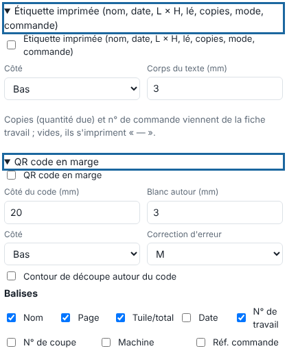

L'étiquette et le QR code identifient chaque lé sur le support imprimé. Cet article s'adresse aux opérateurs.

## Avant de commencer

Vous êtes dans **Édition rapide**, à l'envoi d'un fichier. Pour remplir copies et commande, renseignez la fiche travail (voir [Renseigner la fiche travail](rip-renseigner-la-fiche-travail.md)).

## Étapes

1. Ouvrez le bloc **Étiquette imprimée** et cochez-le.
2. Choisissez le **Côté** (haut ou bas de chaque lé) et le **Corps du texte** (mm).
3. Ouvrez le bloc **QR code en marge** et cochez-le.
4. Choisissez le **Côté** du code, le **Côté du code** (mm), le **Blanc autour** (mm) et la **Correction d'erreur** (L, M, Q, H).
5. Dans **Balises**, cochez ce que le code porte : nom, page, tuile/total, date, n° de travail, n° de coupe, machine, réf. commande.
6. Pour une découpe du code, cochez **Contour de découpe autour du code**.

   
7. Cliquez **Envoyer au RIP**.

## Bon à savoir

- L'étiquette porte le nom, la date, L × H, le lé, les copies, le mode et la commande.
- Copies et référence de commande s'impriment vides (« — ») tant que la fiche travail n'existe pas.
- La marge s'agrandit d'elle-même pour loger l'étiquette et le code.

## Voir aussi

- [Renseigner la fiche travail](rip-renseigner-la-fiche-travail.md)
- [Régler l'édition rapide d'un travail](rip-regler-l-edition-rapide-d-un-travail.md)
- [Couper une page en lés et en tuiles](rip-couper-une-page-en-les-et-en-tuiles.md)
