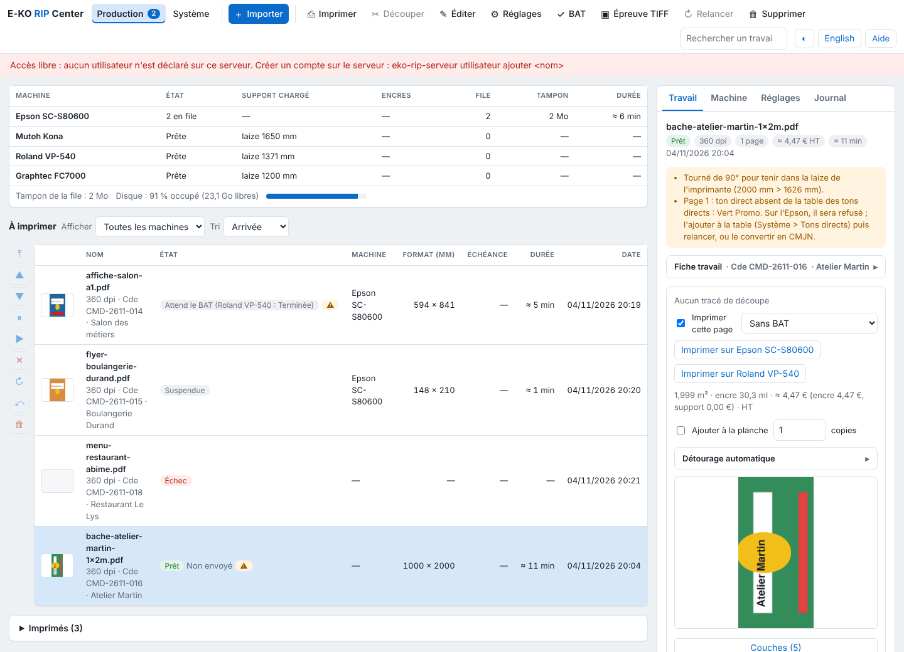

La vue **Production** montre en un coup d'œil l'état des machines, la file et les sorties finies. Cet article explique chaque zone pour les opérateurs.

## Avant de commencer

Un compte **Opérateur** suffit. La vue **Production** est la première du client, à côté de **Système**.

## Étapes

1. Lisez la zone **Machines**, en haut : une ligne par machine, avec son état (prête, en cours et la sortie qui passe, injoignable), le support chargé, les niveaux d'encre de l'Epson, le nombre de sorties en file, leur poids dans le tampon (les plaques à envoyer) et la durée restante.
2. Cliquez une ligne pour n'afficher que cette machine ; un second clic les remet toutes (même choix que la liste **Afficher**).
3. Sous le tableau, lisez le tampon de toute la file et le disque des données (% occupé, place libre, jauge). La jauge passe au rouge quand le libre passe sous le seuil de purge (`EKO_RIP_SEUIL_LIBRE_MO`). Ces compteurs se relisent avec la file.
4. Lisez la zone **À imprimer** : les sorties en file, dans l'ordre de la file, puis les travaux pas encore envoyés (« Non envoyé »). Colonnes : vignette, nom, état, machine, format, échéance, durée, date. Les planches en préparation s'affichent au-dessus.
5. Utilisez la colonne de boutons à gauche pour agir sur la sortie choisie : **En tête**, **Monter**, **Descendre**, **Suspendre**, **Reprendre**, **Annuler**, **Refaire**, **Restaurer**, **Retirer**.
6. Ouvrez la zone repliable **Imprimés** (avec leur nombre) : les sorties finies, en échec ou annulées, la plus récente d'abord, avec l'heure de fin et le relevé d'encre et de support.
7. Cliquez une ligne : l'**inspecteur**, à droite, ouvre le travail. Il a quatre onglets : **Travail**, **Machine**, **Réglages** et **Journal**.

   

## Bon à savoir

- Onglet **Travail** : le détail du travail (voir [Suivre les travaux et lancer l'impression](rip-suivre-les-travaux.md)). Onglet **Machine** : le support, les encres, les chauffages et les alertes de la machine affichée ou de la sortie choisie. Onglet **Réglages** : déposer un fichier sur un réglage l'importe avec ce réglage ; un clic ouvre l'import avec lui. Onglet **Journal** : les messages de l'écran, le plus récent d'abord.
- **Clic droit** sur une ligne : les actions de file de la sortie, puis celles de la barre d'outils. Sur une machine : n'afficher qu'elle, voir son état, relire l'Epson, la configurer. Sur l'en-tête d'un tableau : les colonnes à montrer ou à masquer (nom, état et vignette restent ; le choix est gardé par le poste).
- **Glisser-déposer** : dans **À imprimer**, une sortie en attente ou suspendue se pose à la place d'une autre de la même machine.
- Un bouton grisé ne s'applique pas à l'état de la sortie choisie.
- Le nombre de sorties à passer s'affiche sur le bouton **Production**.
- Quand une sortie se termine ou échoue, l'écran le dit, et le système aussi si le client a l'autorisation d'afficher des notifications.

## Voir aussi

- [Gérer la file d'une machine](rip-gerer-la-file-d-une-machine.md)
- [Comprendre les raisons d'attente d'une sortie](rip-comprendre-les-raisons-d-attente-d-une-sortie.md)
- [Prendre en main l'écran du client](rip-prendre-en-main-l-ecran-du-client.md)
