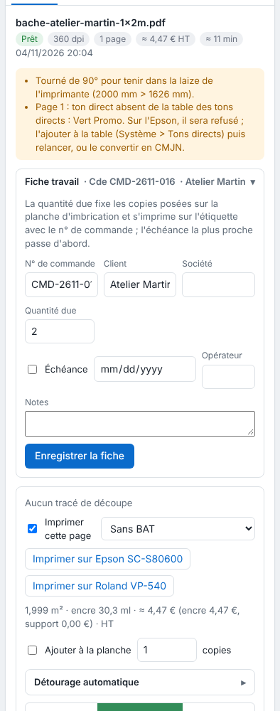

Le RIP vérifie chaque fichier reçu et signale ce qui peut mal tourner. Les alertes n'empêchent jamais le travail de partir : c'est à vous de juger.

## Avant de commencer

Un travail est reçu. Le badge ⚠ s'affiche à côté de son état dans le tableau.

## Étapes

1. Cliquez le travail dans le tableau : les alertes s'affichent en haut de l'inspecteur.

   
2. Lisez chaque alerte. Les plus courantes :
   - **police non incorporée** : une autre police sera prise au rendu. Vectorisez le texte ou incorporez la police, puis renvoyez le fichier ;
   - **image de moins de 100 ppi** à sa taille imprimée : l'image sera floue. Utilisez une image plus définie ;
   - **ton direct absent de la table** : voir [Déclarer les tons directs de l'atelier](../rip-couleur/rip-declarer-les-tons-directs.md) ;
   - **alertes de découpe** (tracé qui touche le bord, ton RVB, etc.) : voir [Comprendre le contrôle préalable de la découpe](rip-comprendre-le-controle-prealable-de-la-decoupe.md) ;
   - **alerte de repérage** : une image de moins de 25 cm de côté est signalée pour un repérage Kona.
3. Corrigez le fichier et renvoyez-le, ou acceptez l'alerte et mettez le travail en file.

## Bon à savoir

- Pour refuser automatiquement les fichiers dont une police manque, cochez **Refuser si une police manque** : voir [Trier les fichiers à l'arrivée](rip-trier-les-fichiers-a-l-arrivee.md).
- Une rotation de 90° faite par le RIP (**Tourner seul si le visuel dépasse la laize**) est signalée par une alerte.
- Une image sans résolution enregistrée est comptée à 72 ppi, et le travail le signale.
- Une épreuve TIFF qui échoue est signalée dans les alertes, sans arrêter le travail.
- Un nom de fichier qui ne suit pas le motif à balises ajoute l'alerte « Nom hors du motif à balises » ou « Balise du nom non reconnue » : voir [Nommer un fichier avec des balises](rip-nommer-un-fichier-avec-des-balises.md).

## Voir aussi

- [Suivre les travaux et lancer l'impression](rip-suivre-les-travaux.md)
- [Envoyer un travail au RIP](rip-envoyer-un-travail.md)
- [Résoudre un rendu en échec ou un fichier refusé](../rip-depannage/rip-un-rendu-echoue.md)
