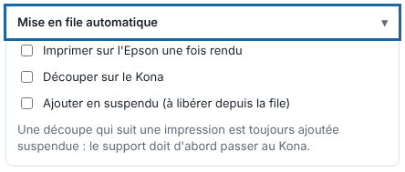

La mise en file automatique envoie chaque page à la bonne machine dès la fin du rendu, sans clic. Elle sert surtout aux dossiers surveillés. Cet article s'adresse aux opérateurs.

## Avant de commencer

L'imprimante et la découpeuse sont déclarées dans le catalogue des machines (voir [Ajouter une machine au RIP](../rip-machines/rip-ajouter-une-machine.md)). Pour découper, choisissez la **Découpeuse** dans le panneau d'envoi.

## Étapes

1. Cliquez **Importer**, puis ouvrez le bloc **Mise en file automatique**.
2. Cochez **Imprimer sur l'Epson une fois rendu** : chaque page imprimable part dans la file de l'Epson.
3. Cochez **Découper sur le Kona** (ou sur la découpeuse choisie à l'import) : chaque page à découper part dans la file de la découpeuse.
4. Cochez **Ajouter en suspendu (à libérer depuis la file)** si vous voulez que les sorties attendent : vous importez dix fichiers et vous libérez ceux que vous voulez.

   
5. Cliquez **Envoyer au RIP**.
6. Pour libérer une sortie suspendue, ouvrez la file de la machine, cliquez la sortie, puis **Reprendre**.
7. Pour garder ce choix, cliquez **Enregistrer…**, à côté de **Réglage** : un dossier surveillé qui utilise ce réglage imprime alors tout seul.

## Bon à savoir

- Une découpe qui suit une impression est toujours ajoutée suspendue : le support doit d'abord passer à la découpeuse. Elle attend aussi que l'impression de sa page soit finie à 100 %.
- On peut choisir plusieurs fichiers à la fois : ils partent chacun avec les mêmes réglages.
- Le réglage s'enregistre avec les autres (voir [Déposer un fichier dans un dossier surveillé](rip-deposer-un-fichier-dans-un-dossier-surveille.md)).
- Sans mise en file automatique, vous mettez la page en file avec **Imprimer sur…** et **Découper sur…** (voir [Suivre les travaux et lancer l'impression](rip-suivre-les-travaux.md)).
- Avec **Épreuve seule** (voir [Faire une épreuve TIFF](../rip-couleur/rip-faire-une-epreuve-tiff.md)), la mise en file d'une impression est refusée.

## Voir aussi

- [Choisir la découpeuse d'un travail](rip-choisir-la-decoupeuse-d-un-travail.md)
- [Gérer la file d'une machine](rip-gerer-la-file-d-une-machine.md)
- [Déposer un fichier dans un dossier surveillé](rip-deposer-un-fichier-dans-un-dossier-surveille.md)
