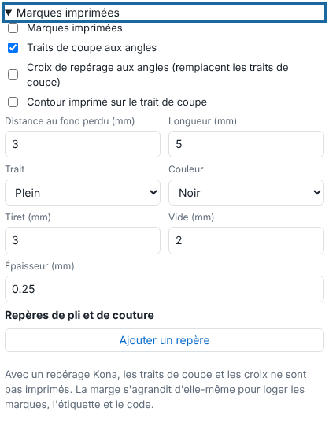

Les œillets et les marques guident la finition : poser les œillets d'une bâche, couper aux angles, plier ou coudre. Cet article s'adresse aux opérateurs.

## Avant de commencer

Vous êtes dans le bloc **Édition rapide** du panneau d'envoi ou de l'édition d'un travail fini (voir [Régler l'édition rapide d'un travail](rip-regler-l-edition-rapide-d-un-travail.md)).

## Étapes

1. Cochez **Œillets (repères imprimés)**.
2. Choisissez la **Répartition** : **par espacement** (réglez l'**Écart maximal**, en mm) ou **par quantité** (saisissez un **Nombre par bord**, coins compris : haut, bas, gauche, droite).
3. Réglez la **Distance au bord** (mm), le **Diamètre** (mm), les bords concernés (**Haut**, **Bas**, **Gauche**, **Droite**) et la **Forme** : cercle, disque plein, croix, cercle et croix. Les coins sont compris.
4. Si le retrait doit partir du contour de découpe et non du bord, cochez **Distance comptée depuis le trait de coupe (vers l'intérieur)**.
5. Ouvrez **Marques imprimées** et cochez **Marques imprimées**. Choisissez :
   - **Traits de coupe aux angles**, avec la **Distance au fond perdu** et la **Longueur** ; ou **Croix de repérage aux angles** (elles remplacent les traits de coupe) ;
   - **Contour imprimé sur le trait de coupe**.

   
6. Pour un pli ou une couture, cliquez **Ajouter un repère**, choisissez le côté et la **distance au côté**. Cochez **Couture (trait continu)** si besoin. Décochez **Imprimé** pour ne pas imprimer le repère.
7. Réglez le **Trait** : plein, pointillé ou alterné (tirets sur blanc), avec **Tiret**, **Vide**, **Épaisseur** et **Couleur** (noir, repérage CMJN 100 %, blanc).
8. Cliquez **Envoyer au RIP**.

## Bon à savoir

- 20 repères de pli et de couture au plus.
- Les marques se posent hors du fond perdu (voir [Ajouter un fond perdu](rip-ajouter-un-fond-perdu.md)).
- Avec un repérage Kona, les traits de coupe et les croix ne sont pas imprimés (ils gêneraient la lecture des repères) : une alerte le dit sur le travail.
- La marge s'agrandit d'elle-même pour loger les marques.

## Voir aussi

- [Régler l'édition rapide d'un travail](rip-regler-l-edition-rapide-d-un-travail.md)
- [Choisir le repérage Kona](../rip-machines/rip-choisir-le-reperage-kona.md)
- [Ajouter un fond perdu](rip-ajouter-un-fond-perdu.md)
