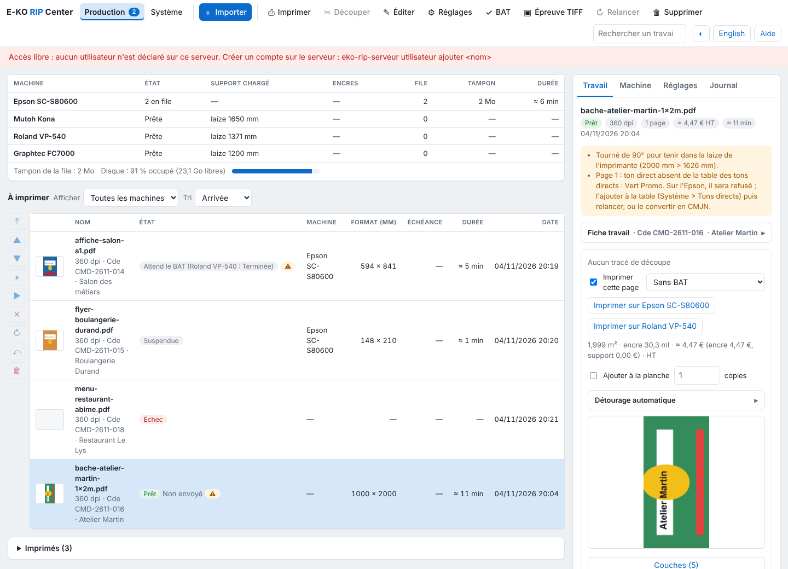

L'écran du client se lit comme une file de RIP : on dépose un fichier, on suit le travail, on le met en file sur une machine. Cet article présente chaque zone, pour les opérateurs qui découvrent le client.

## Avant de commencer

Le client E-KO RIP Center est installé et connecté au serveur (voir [Se connecter au serveur](../rip-premiers-pas/rip-se-connecter-au-serveur.md)). Si le serveur a des comptes, le client demande d'abord votre identifiant et votre mot de passe.

## Étapes

1. Regardez **en haut** : la barre d'outils. Elle contient **Importer**, puis les actions qui s'appliquent au travail choisi : **Imprimer**, **Découper**, **Éditer**, **Réglages**, **BAT**, **Épreuve TIFF**, **Relancer** et **Supprimer**. Un bouton grisé ne s'applique pas à l'état du travail choisi.
2. Repérez, à droite de la barre, la **recherche** (nom, n° de commande, client ou société), le bouton de thème (sombre ou clair, ◐) et le choix de la langue.
3. Regardez **à gauche** (clients natifs) : les **vues** (**Travaux**, **File d'attente**, **Système**), les **machines** du catalogue avec le nombre de sorties en file (un clic ouvre leur file) et les **réglages enregistrés** (un clic ouvre l'import avec ce réglage).
4. Regardez **au centre** : le tableau des travaux.
5. Regardez **à droite** : l'**inspecteur** du travail choisi (aperçu, alertes, fiche travail, boutons **Imprimer sur…** et **Découper sur…**).

   
6. Cliquez **Importer** pour envoyer un fichier (voir [Envoyer un travail au RIP](rip-envoyer-un-travail.md)).

## Bon à savoir

- Dans le client web d'administration, la vue **Production** remplace **Travaux** et **File d'attente** : voir [Lire l'écran Production](rip-lire-l-ecran-production.md).
- Sur un écran de moins de 1100 px, l'inspecteur passe sous les tableaux ; sous 1360 px, les outils de la barre gardent leur symbole et leur nom passe en bulle.
- Le choix du thème et de la langue est gardé par le poste.
- La vue **Système** réunit la version du serveur, la découpe, les machines, les supports, les coûts et les sauvegardes : voir [Lire la vue Système](../rip-couleur/rip-lire-la-vue-systeme.md).

## Voir aussi

- [Lire l'écran Production](rip-lire-l-ecran-production.md)
- [Suivre les travaux et lancer l'impression](rip-suivre-les-travaux.md)
- [Envoyer un travail au RIP](rip-envoyer-un-travail.md)
