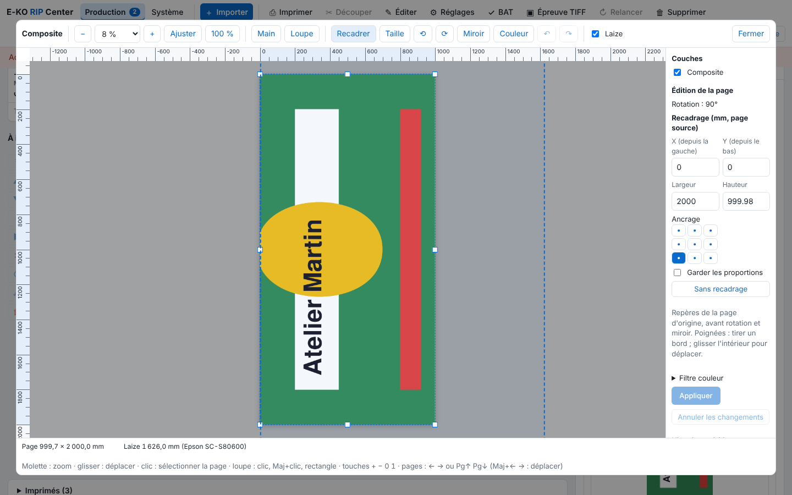

Les outils d'édition de la visionneuse corrigent une page sans renvoyer le fichier. Cet article s'adresse aux opérateurs.

## Avant de commencer

Le travail est un PDF rendu, sans mosaïque : les outils d'édition ne s'ouvrent que dans ce cas. Un travail qui a une sortie en file ne s'édite pas.

## Étapes

1. Ouvrez la page dans la visionneuse (voir [Utiliser la visionneuse pour contrôler un travail](rip-utiliser-la-visionneuse.md)).
2. Pour recadrer, cliquez **Recadrer**. Tirez un bord ou une poignée, ou glissez l'intérieur pour déplacer. Vous pouvez aussi saisir X (depuis la gauche), Y (depuis le bas), **Largeur** et **Hauteur**, en mm de la page d'origine, avant rotation et miroir. Choisissez l'**Ancrage** sur 9 points, cochez **Garder les proportions**, ou cliquez **Sans recadrage**.

   
3. Pour changer la taille, cliquez **Taille**. Réglez la **Taille imprimée** en largeur et hauteur (mm) ou en %. Les angles agissent en proportionnel, les côtés librement. Décochez **Proportions liées** pour régler largeur et hauteur à part : la découpe se déforme pareil. Le coin haut gauche reste fixe.
4. Pour tourner, cliquez **Tourner de 90° à gauche** (⟲) ou **à droite** (⟳). Pour retourner, cliquez **Miroir**, puis choisissez **Le miroir retourne** : l'image et la découpe, ou l'image seule.
5. Cliquez **Appliquer** : le rendu est refait. **Annuler les changements** revient à l'état rendu.

## Bon à savoir

- Un cadre qui sort de la page est refusé (1 × 1 mm au moins).
- **Annuler / rétablir** : ↶ et ↷, ou Ctrl+Z (Cmd+Z), Maj+Ctrl+Z et Ctrl+Y ; 50 états au plus. Revenir à un état déjà rendu refait le rendu ; un état seulement saisi revient dans le panneau.
- Pendant un recadrage ou un changement de taille avec un repérage Kona, les repères sont dessinés en pointillés autour de la taille à venir.
- Le choix « l'image seule » du miroir est à éprouver à l'atelier. Un travail en miroir porte le badge **Miroir** dans la file.

## Voir aussi

- [Régler l'édition rapide d'un travail](rip-regler-l-edition-rapide-d-un-travail.md)
- [Utiliser la visionneuse pour contrôler un travail](rip-utiliser-la-visionneuse.md)
- [Retoucher les couleurs d'un travail avec le filtre couleur](../rip-couleur/rip-retoucher-les-couleurs-avec-le-filtre-couleur.md)
