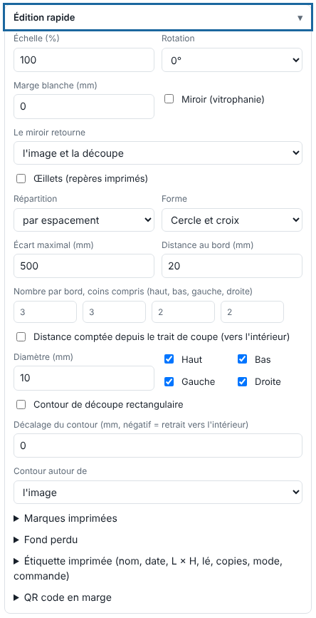

L'édition rapide corrige un fichier sans repasser par le logiciel de mise en page : taille, sens, miroir, contour. Cet article s'adresse aux opérateurs.

## Avant de commencer

Vous êtes à l'envoi d'un fichier (**Importer**), ou vous avez un travail fini. Un travail qui a une sortie en file ne s'édite pas : annulez ou finissez d'abord la sortie.

## Étapes

1. Pour un nouveau fichier, cliquez **Importer** et ouvrez le bloc **Édition rapide**. Pour un travail fini, cliquez le travail, puis **Éditer** dans la barre d'outils : le rendu est refait depuis le fichier d'origine, sans le renvoyer.

   
2. Réglez l'**Échelle** (%) et la **Rotation** (0, 90, 180 ou 270°).
3. Réglez la **Marge blanche** (mm) autour de l'image.
4. Pour une vitrophanie (caisson vu de l'arrière), cochez **Miroir (vitrophanie)**, puis choisissez **Le miroir retourne** : **l'image et la découpe** (par défaut) ou **l'image seule**.
5. Pour une découpe rectangulaire, cochez **Contour de découpe rectangulaire**. Réglez le **Décalage du contour** (mm ; négatif = retrait vers l'intérieur) et choisissez **Contour autour de** : l'image, le fond perdu, ou la boîte de rognage (fond perdu + rogne).
6. Cliquez **Envoyer au RIP**, ou **Appliquer** dans l'édition d'un travail fini.

## Bon à savoir

- Le miroir « image seule » est à éprouver à l'atelier : selon la pose, la découpe doit suivre l'image ou non.
- La découpe suit l'édition (échelle, rotation, miroir).
- La marge s'agrandit d'elle-même pour loger les marques, l'étiquette et le code.
- Un travail en miroir porte le badge **Miroir** dans la file.
- Avec une rotation choisie ici, **Tourner seul si le visuel dépasse la laize** est sans effet.
- Pour des œillets et des marques, voir [Poser des œillets et des marques imprimées](rip-poser-des-oeillets-et-des-marques-imprimees.md). Pour recadrer ou redimensionner sur l'aperçu, voir [Recadrer, redimensionner ou tourner une page](rip-recadrer-redimensionner-ou-tourner-une-page.md).

## Voir aussi

- [Poser des œillets et des marques imprimées](rip-poser-des-oeillets-et-des-marques-imprimees.md)
- [Ajouter un fond perdu](rip-ajouter-un-fond-perdu.md)
- [Envoyer un travail au RIP](rip-envoyer-un-travail.md)
