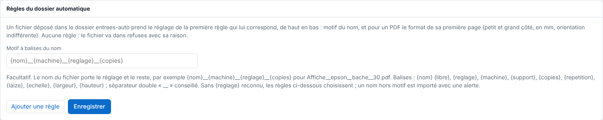

Le dossier automatique choisit seul le réglage d'un fichier d'après son nom et son format. Cet article s'adresse à l'administrateur.

## Avant de commencer

Il vous faut un compte administrateur. Les réglages que les règles doivent appliquer existent déjà (voir [Déposer un fichier dans un dossier surveillé](rip-deposer-un-fichier-dans-un-dossier-surveille.md)). Le dossier est `/var/lib/eko-rip/entrees-auto/` sur le serveur.

## Étapes

1. Ouvrez **Administration…**, vue **Système**, bloc **Règles du dossier automatique**.
2. Cliquez **Ajouter une règle**.
3. Saisissez le **Motif du nom** : `*` remplace n'importe quels caractères, `?` un seul, sans tenir compte des majuscules.
4. Au besoin, saisissez le **Petit côté** et le **Grand côté** (mm, facultatifs) : le format de la première page d'un PDF, quelle que soit son orientation. Une borne vide vaut 0 ou 100 m.
5. Choisissez le réglage à appliquer.
6. Ordonnez les règles : elles sont essayées de haut en bas (**↑** pour remonter une règle), et la première qui correspond donne son réglage.
7. Cliquez **Enregistrer**.

   
8. Déposez un fichier dans `entrees-auto/` pour vérifier.

## Bon à savoir

- Exemple : `BACHE_*` → Bâche ; `*.pdf`, grand côté de 2000 à vide → Grand format ; `*` → Vinyle.
- `BACHE_*` prend `BACHE_client-12.pdf`, pas `affiche_BACHE.pdf`.
- Une règle de format ne prend jamais un fichier dont le format n'est pas lu (image, SVG, PDF de plus de 512 Mo) : mettez une règle sans format après elle.
- Un fichier qu'aucune règle ne prend va dans `entrees-auto/refuses/` avec sa raison (fichier `.refus.txt`).
- Les règles sont dans la sauvegarde de la configuration (voir [Sauvegarder la configuration du serveur](../rip-administration/rip-sauvegarder-la-configuration.md)).
- Pour que le nom porte aussi la machine, les copies ou l'échelle, voir [Nommer un fichier avec des balises](rip-nommer-un-fichier-avec-des-balises.md).

## Voir aussi

- [Nommer un fichier avec des balises](rip-nommer-un-fichier-avec-des-balises.md)
- [Déposer un fichier dans un dossier surveillé](rip-deposer-un-fichier-dans-un-dossier-surveille.md)
- [Partager les dossiers surveillés](../rip-administration/rip-partager-les-dossiers-surveilles.md)
