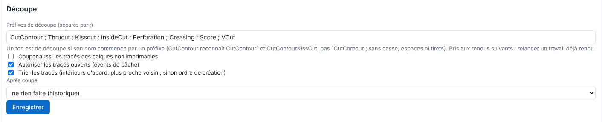

Le RIP reconnaît un tracé de découpe à son nom de ton. Cet article explique comment l'adapter aux habitudes de l'atelier. Il s'adresse à l'administrateur.

## Avant de commencer

Il vous faut un compte administrateur. Vos fichiers nomment leurs tons de découpe d'une façon cohérente.

## Étapes

1. Ouvrez **Administration…**, vue **Système**, bloc **Découpe**.
2. Dans **Préfixes de découpe (séparés par ;)**, saisissez les préfixes. Un ton est de découpe si son nom **commence** par un préfixe.

   
3. Cliquez **Enregistrer**.
4. Relancez les travaux déjà rendus : un changement vaut pour les rendus suivants.

## Bon à savoir

- Préfixes par défaut : `CutContour`, `Thrucut`, `Kisscut`, `InsideCut`, `Perforation`, `Creasing`, `Score`, `VCut`.
- Majuscules, espaces et tirets sont indifférents : `CutContour` reconnaît `CutContour1` et `CutContourKissCut`, pas `1CutContour`.
- Un ton de découpe à 0 % n'est pas découpé.
- Avec **Tous les tracés** (choix **Tracés à découper** de l'envoi), chaque tracé du fichier est découpé : pratique pour les fichiers de découpe seule.
- Les tracés sont rognés à la page, et au cadre d'un formulaire du PDF : la lame ne sort jamais du support.
- Les tons de découpe ne sont jamais imprimés et n'effacent pas l'encre sous eux, même sans surimpression : au rendu, ils deviennent le colorant `None` de la norme PDF. Il n'y a donc pas de liseré blanc le long de la découpe.
- Pour couper aussi les tracés des calques non imprimables, cochez **Couper aussi les tracés des calques non imprimables** (voir [Régler les tracés ouverts, le tri et l'après-coupe](rip-regler-les-traces-ouverts-le-tri-et-l-apres-coupe.md)).

## Voir aussi

- [Comprendre le contrôle préalable de la découpe](rip-comprendre-le-controle-prealable-de-la-decoupe.md)
- [Ordonner les couches de découpe](rip-ordonner-les-couches-de-decoupe.md)
- [Régler les tracés ouverts, le tri et l'après-coupe](rip-regler-les-traces-ouverts-le-tri-et-l-apres-coupe.md)
