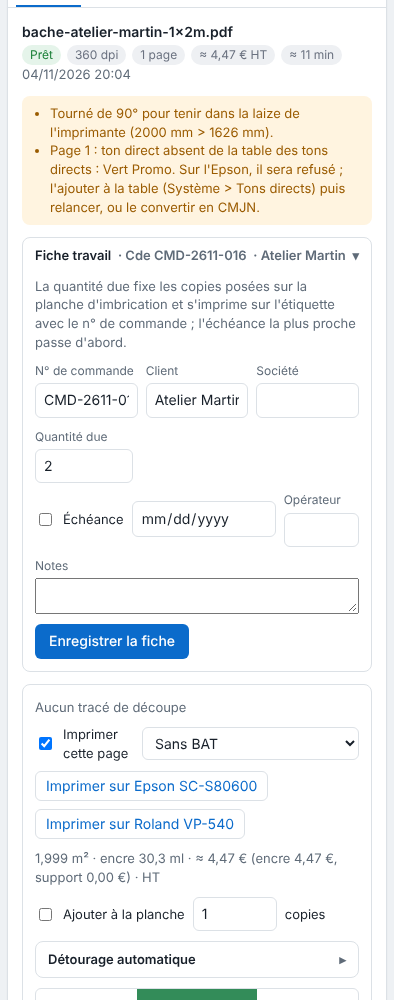

La fiche travail garde les informations de commande d'un travail. La quantité due et l'échéance servent aussi à l'imbrication. Cet article s'adresse aux opérateurs.

## Avant de commencer

Un travail est reçu (voir [Envoyer un travail au RIP](rip-envoyer-un-travail.md)). Un compte **Opérateur** suffit.

## Étapes

1. Cliquez le travail dans le tableau.
2. Dans l'inspecteur, ouvrez la **Fiche travail** : elle est repliée sous son titre, avec son résumé (n° de commande, client).
3. Remplissez les champs voulus : **N° de commande**, **Client**, **Société**, **Quantité due**, **Échéance**, **Opérateur** et **Notes**. Pour l'échéance, cochez la case, puis choisissez la date.
4. Cliquez **Enregistrer la fiche**.

   
5. Pour trier la file par date limite, choisissez **Échéance** dans la liste **Tri** au-dessus du tableau ; **Arrivée** revient à l'ordre d'arrivée.

## Bon à savoir

- Limites : 200 caractères par champ, 2000 pour les notes, quantité de 100 000 au plus.
- La **Quantité due** est le nombre de **copies** posées sur la planche d'imbrication ; elle s'imprime sur l'étiquette avec le n° de commande.
- L'**échéance** est la priorité de l'imbrication : la plus proche passe d'abord, puis les travaux sans échéance, puis l'ordre d'arrivée. Le tableau a une colonne **Échéance**.
- La barre de recherche filtre par nom, n° de commande, client ou société.
- **Opérateur** apparaît dans le journal des impressions.
- Un nom de fichier peut remplir la quantité : voir [Nommer un fichier avec des balises](rip-nommer-un-fichier-avec-des-balises.md).

## Voir aussi

- [Imprimer une étiquette et un QR code en marge](rip-imprimer-une-etiquette-et-un-qr-code.md)
- [Suivre une planche dans la file](rip-suivre-une-planche-dans-la-file.md)
- [Consulter le journal des impressions](../rip-couleur/rip-consulter-le-journal-des-impressions.md)
