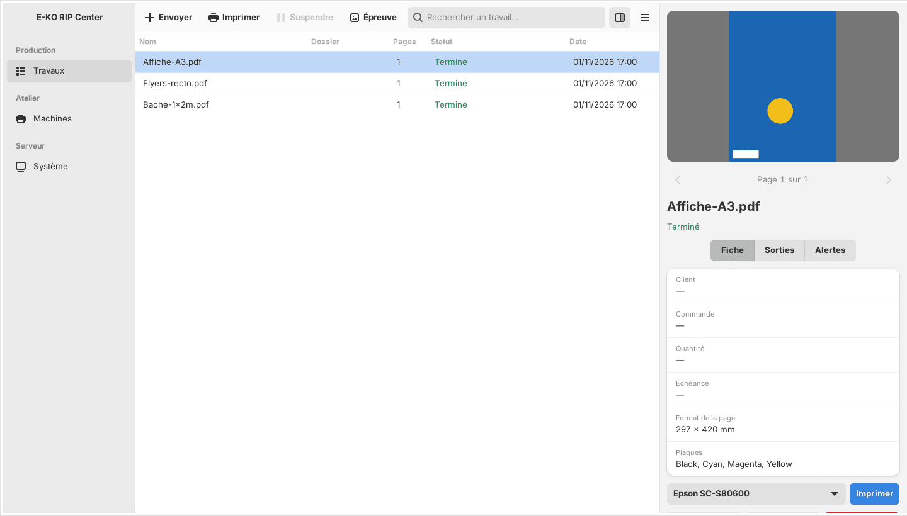

Après l'envoi, vous suivez chaque travail dans le client, puis vous le mettez en file sur une machine. Cet article s'adresse aux opérateurs.

## Avant de commencer

Un fichier a été envoyé (voir [Envoyer un travail](rip-envoyer-un-travail.md)). Un compte **Opérateur** suffit.

## Étapes

1. Ouvrez la vue **Travaux**. Le tableau liste le nom, le dossier, les pages, l'état et la date. Utilisez la recherche pour filtrer par nom, numéro de commande, client ou société.
2. Cliquez un travail : l'inspecteur, à droite, montre l'aperçu, la fiche, les plaques d'encre et les alertes.
3. Lisez les alertes (badge ⚠) avant d'aller plus loin.
4. Cliquez **Imprimer sur…** pour la machine voulue. La page entre dans la file de cette machine.
5. Pour une découpe, cliquez **Découper sur…** pour la découpeuse voulue.
6. Au besoin, ouvrez la fiche travail : **N° de commande**, **Client**, **Société**, **Quantité due**, **Échéance**, **Opérateur** et **Notes**, puis **Enregistrer la fiche**.

## Bon à savoir

- Le badge à côté de chaque bouton donne l'état de la dernière sortie.
- La case **Imprimer cette page** est cochée par défaut. Décochée, la page n'entre ni dans la file ni dans une planche.
- **Relancer** refait un travail en échec. **Supprimer** efface un travail fini, mais pas tant qu'une sortie l'attend dans la file.
- **Fichier .plt** télécharge la découpe en HP-GL.
- Pour imprimer et découper sans intervention, cochez **Mise en file automatique** à l'envoi. **Ajouter en suspendu** met les sorties en attente, pour les libérer ensuite depuis la file.
- Une découpe qui suit une impression est toujours ajoutée suspendue : le support doit d'abord passer à la découpeuse.

## Voir aussi

- [Gérer la file d'une machine](rip-gerer-la-file-d-une-machine.md)
- [Valider un BAT avec le client](rip-valider-un-bat.md)
- [Suivre la production depuis l'application mobile](rip-suivre-la-production-sur-mobile.md)
- Page détaillée : https://e-ko.rip/documentation/utilisation/
