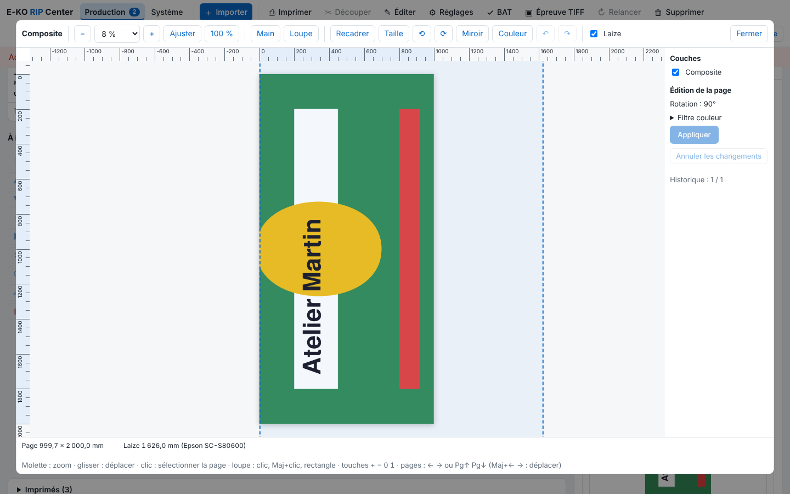

La visionneuse ouvre l'aperçu d'un travail en grand, pour contrôler les cotes, la laize et les plaques avant d'imprimer. Cet article s'adresse aux opérateurs.

## Avant de commencer

Le rendu du travail est fini. Un compte **Opérateur** suffit.

## Étapes

1. Cliquez le travail, puis une vignette (composite, plaque ou découpe) dans l'inspecteur : elle s'ouvre en grand.

   
2. Zoomez : molette (le point sous le curseur reste fixe), boutons **−** et **+**, liste des pourcentages (de 25 à 800 %), **Ajuster** ou **100 %** (taille réelle à l'écran).
3. Choisissez l'outil **Main** (glisser pour déplacer) ou **Loupe** (clic : zoom avant ; Maj+clic : zoom arrière ; tirer un rectangle : zoom sur ce rectangle).
4. Lisez les règles en mm sur deux bords, et en bas les dimensions de la page et la position du curseur en mm.
5. Cochez **Laize** : la largeur du support chargé dans l'Epson (sinon la laize de la machine) est dessinée. Ce qui dépasse est en rouge, avec l'écart en mm.
6. Dans le panneau **Couches**, à droite, activez ou masquez une à une l'image, la découpe (en magenta), le blanc et l'argent.
7. Sur un travail de plusieurs pages, changez de page dans le bandeau de vignettes, avec ← → ou Pg↑ Pg↓. La vue choisie (composite, découpe, plaque) est gardée.
8. Cliquez la page pour la sélectionner (cadre et 8 poignées) ; un clic hors de la page la désélectionne.
9. Cliquez **Fermer**.

## Bon à savoir

- Clavier : `+` `−` `0` `1` et les flèches.
- Le blanc et l'argent sont les plaques aux noms que reconnaît l'Epson, teintées sur l'image. Les repères Kona sont imprimés dans la plaque Black : pas de couche séparée.
- La découpe ne se superpose que si la coupe est posée comme l'impression (sans rotation ni miroir de [mise en coupe](rip-mettre-en-coupe-un-travail.md)).
- La visionneuse permet aussi de modifier la page (voir [Recadrer, redimensionner ou tourner une page](rip-recadrer-redimensionner-ou-tourner-une-page.md)), de retoucher les couleurs (voir [Retoucher les couleurs d'un travail avec le filtre couleur](../rip-couleur/rip-retoucher-les-couleurs-avec-le-filtre-couleur.md)) et de régler les lés (voir [Couper une page en lés et en tuiles](rip-couper-une-page-en-les-et-en-tuiles.md)).

## Voir aussi

- [Recadrer, redimensionner ou tourner une page](rip-recadrer-redimensionner-ou-tourner-une-page.md)
- [Comprendre les plaques d'encre et les noms de tons directs](../rip-couleur/rip-comprendre-les-plaques-et-les-tons-directs.md)
- [Suivre les travaux et lancer l'impression](rip-suivre-les-travaux.md)
