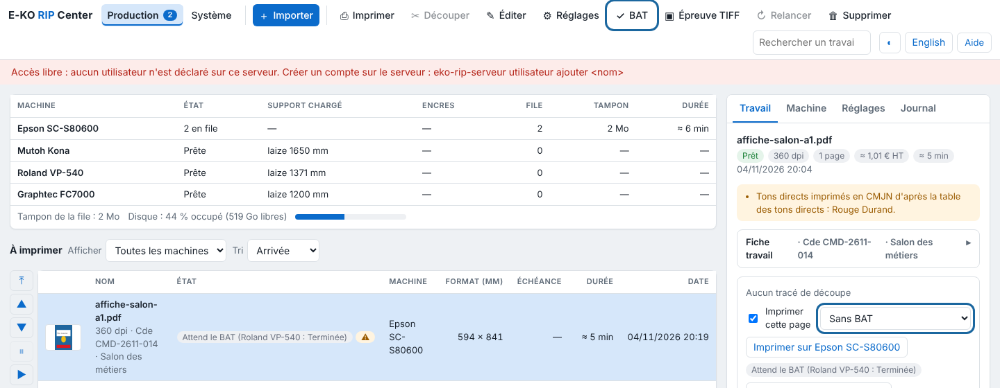
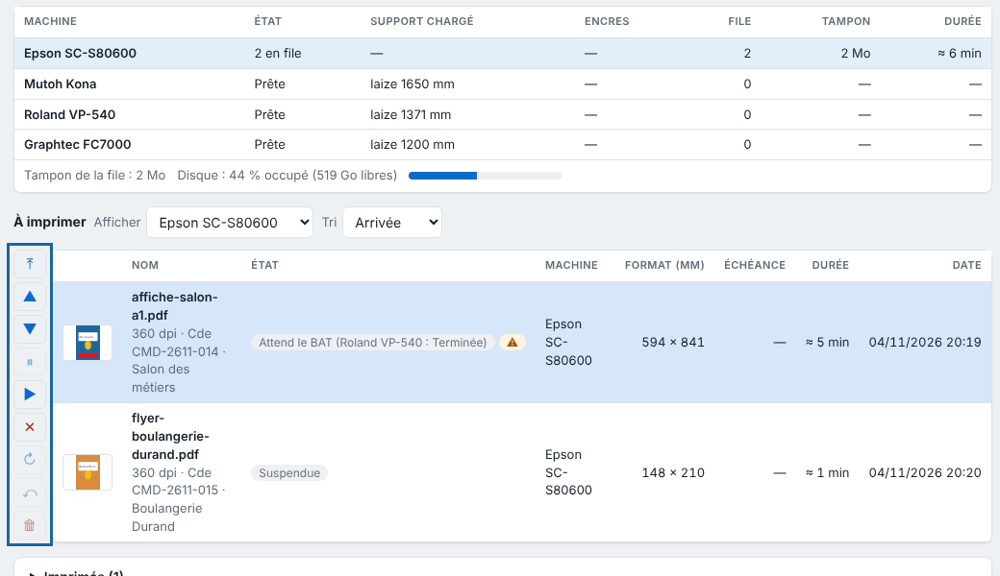

Le BAT est le document que le client signe avant l'impression. Cet article explique comment le produire, ou imprimer une épreuve sur une autre machine.

## Avant de commencer

Le rendu du travail est fini. Pour l'épreuve sur une autre machine, le RIP doit avoir au moins deux imprimantes.

## Étapes

1. Cliquez le travail fini dans le tableau.
2. Cliquez **BAT** dans la barre d'outils. Le RIP produit un PDF A4 paysage, une page par page du travail.
3. Envoyez ce PDF au client. Il porte l'image en épreuve écran, le tracé de découpe en magenta, le format, les réglages, les alertes et un cadre « Bon pour accord » (date, nom et signature).
4. Pour une épreuve imprimée, choisissez la machine d'épreuve dans la liste de l'inspecteur (**Sans BAT**, **BAT sur …**), au-dessus de **Imprimer sur…**.

   
5. Cliquez **Imprimer sur…** : deux sorties entrent en file. La copie « nom-BAT » part sur la machine d'épreuve ; l'impression demandée est suspendue et affiche **Attend le BAT**.
6. Si le client accepte, cliquez **Reprendre** sur l'original. S'il refuse, cliquez **Annuler**.

   

## Bon à savoir

- Le BAT est un PDF A4 paysage, une page par page du travail : l'image en épreuve écran du profil de support, le tracé de découpe en magenta (non imprimé), le format en mm, les réglages (mode, résolution, profil, blanc, édition, œillets), les alertes de pré-vérification et un cadre « Bon pour accord » (date, nom et signature).
- Le BAT sort dans la langue de l'écran.
- L'épreuve sur une autre machine se fait en impression seulement, sur une machine différente de celle demandée.
- Le choix **BAT sur…** reste tant que vous ne le changez pas : revenez à **Sans BAT** pour le désactiver.
- Un filtre couleur est mentionné sur le BAT, mais l'épreuve écran ne le montre pas.

## Voir aussi

- [Faire une épreuve TIFF](../rip-couleur/rip-faire-une-epreuve-tiff.md)
- [Suivre les travaux et lancer l'impression](rip-suivre-les-travaux.md)
- [Gérer la file d'une machine](rip-gerer-la-file-d-une-machine.md)
