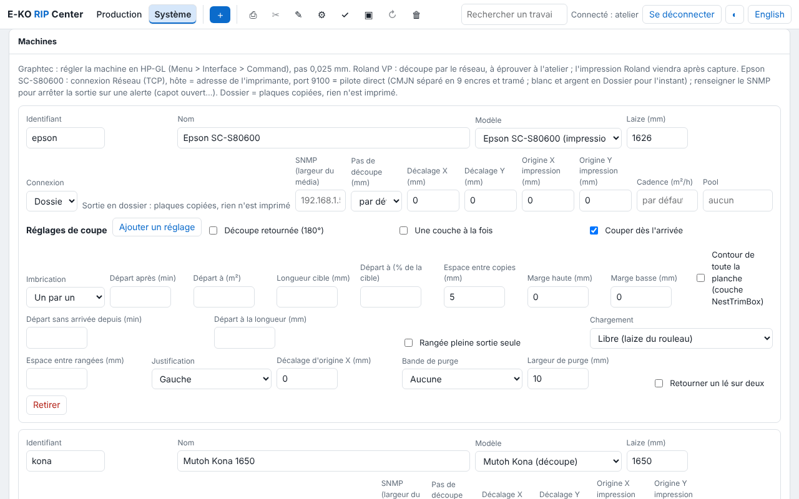

# Machines

Each machine in the catalogue has its own page: what the RIP does with it, how to connect it,
what to set on the machine and in the RIP, how to check, and common trouble. Each feature is
described in [usage](usage.md), running the server in [administration](administration.md),
and the words in the [glossary](glossary.md).

## Supported machines

| Family | Machine | The RIP drives |
|---|---|---|
| **Printers** | [Epson SureColor SC-S80600](machines/epson-sc-s80600.md) | printing (direct driver) |
| | [Roland VersaCAMM VP-300 / VP-540](machines/roland-versacamm.md) | cutting (printer/cutter) |
| **Cutting plotters** | [Mutoh Kona 1650](machines/mutoh-kona.md) | cutting, with registration |
| | [Graphtec FC7000](machines/graphtec-fc7000.md) | cutting |
| **Cutting tables** | [none yet](machines/cutting-tables.md) | |

Each new machine supported by the RIP gets its own page in the right family.

## Adding a machine

In the client, open **Administration…**, **System › Machines** view (*Système › Machines*),
then **Add**: choose the **model**, give an id and a name, the roll width, the connection and
its settings, then save. The **Help** link next to the model opens that machine's page.

For every machine:

- **Id**: lowercase letters, digits and `-` (`epson`, `kona`…). It names the
  `sorties/<machine>/` folder and is used when another RIP forwards to it: do not change it
  lightly.
- **One output at a time**, in the order of the machine's queue. A machine that still has
  an output to run cannot be removed from the catalogue.
- **Fixed IP address** for every network machine (see the
  [server PC requirements](server-installation.md#server-pc-requirements)).

## Connections

| Connection | For | To enter | Check |
|---|---|---|---|
| **Network (TCP)** | Epson (direct driver), Graphtec, Roland | host (fixed IP), port (9100 for the Epson) | `nc -vz <ip> <port>` |
| **Serial / USB-serial** | Kona, cutter on USB-serial | port (`/dev/kona`), `stty` settings | `ls -l <port>`; the service is in `dialout` |
| **Device (USB…)** | machine as a USB printer | path (`/dev/usb/lp0`…) | `ls -l <path>` |
| **Folder** | no driver, third-party software watching the folder | nothing | `ls /var/lib/eko-rip/sorties/<machine>/` |
| **IPP** | **raw** CUPS queue, IPP printer | host, port 631, path (`/printers/<queue>`) | `lpstat -h <host> -p` |
| **Forward to another E-KO RIP** | machine plugged into another E-KO RIP | host, port 8640, the machine's id there, token | `eko-rip-serveur renvoi etat` on the other server |

IPP and forwarding in detail: [administration, machines](administration.md#machines).

## A machine that is not in the list

A machine can already be reached through the **Folder** connection (the RIP drops the files
that the machine's software watches) or through **IPP**. To ask for a model to be supported,
write to [contact@e-ko.rip](mailto:contact@e-ko.rip) with the brand, the model and how it is
connected.
