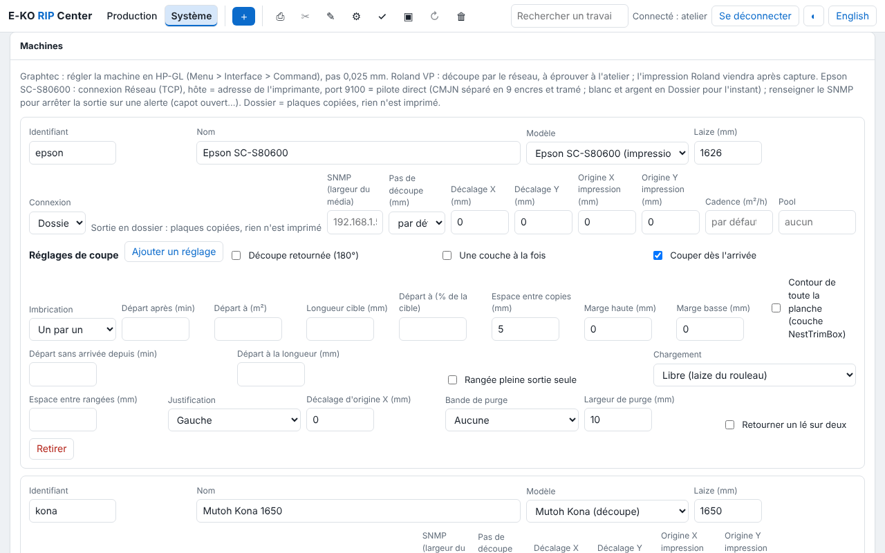

# Machines

Chaque machine du catalogue a sa page : ce que le RIP en fait, comment la brancher, quoi
régler sur la machine et dans le RIP, comment vérifier, et les ennuis courants. Le détail
des fonctions est dans [l'utilisation](utilisation.md), l'exploitation du serveur dans
[l'administration](administration.md), et les mots dans le [glossaire](glossaire.md).

## Machines prises en charge

| Famille | Machine | Le RIP pilote |
|---|---|---|
| **Imprimantes** | [Epson SureColor SC-S80600](machines/epson-sc-s80600.md) | l'impression (pilote direct) |
| | [Roland VersaCAMM VP-300 / VP-540](machines/roland-versacamm.md) | la découpe (imprimante-découpeuse) |
| **Plotters de découpe** | [Mutoh Kona 1650](machines/mutoh-kona.md) | la découpe, avec repérage |
| | [Graphtec FC7000](machines/graphtec-fc7000.md) | la découpe |
| **Tables de découpe** | [aucune pour l'instant](machines/tables-de-decoupe.md) | |

Chaque nouvelle machine prise en charge par le RIP reçoit sa page dans la bonne famille.

## Ajouter une machine

Dans le client, ouvrir **Administration…**, vue **Système › Machines**, puis **Ajouter** :
choisir le **modèle**, donner un identifiant et un nom, la laize, la connexion et ses
réglages, puis enregistrer. Le lien **Aide** à côté du modèle ouvre la page de cette
machine.

Pour toutes les machines :

- **Identifiant** : minuscules, chiffres et `-` (`epson`, `kona`…). Il nomme le dossier
  `sorties/<machine>/` et sert au renvoi d'un autre RIP : ne pas le changer à la légère.
- **Une sortie à la fois**, dans l'ordre de la file de la machine. Une machine qui a encore
  une sortie à passer ne peut pas être retirée du catalogue.
- **Adresse IP fixe** pour toute machine en réseau (voir les
  [exigences du poste](installation-serveur.md#exigences-du-poste-serveur)).

## Connexions

| Connexion | Pour | À saisir | Vérifier |
|---|---|---|---|
| **Réseau (TCP)** | Epson (pilote direct), Graphtec, Roland | hôte (IP fixe), port (9100 pour l'Epson) | `nc -vz <ip> <port>` |
| **Série / USB-série** | Kona, découpeuse en USB-série | port (`/dev/kona`), réglages `stty` | `ls -l <port>` ; le service est dans `dialout` |
| **Périphérique (USB…)** | machine en USB imprimante | chemin (`/dev/usb/lp0`…) | `ls -l <chemin>` |
| **Dossier** | pas de pilote, logiciel tiers qui surveille le dossier | rien | `ls /var/lib/eko-rip/sorties/<machine>/` |
| **IPP** | file CUPS **raw**, imprimante IPP | hôte, port 631, chemin (`/printers/<file>`) | `lpstat -h <hôte> -p` |
| **Renvoi vers un autre RIP E-KO** | machine branchée sur un autre RIP E-KO | hôte, port 8640, identifiant de la machine là-bas, jeton | `eko-rip-serveur renvoi etat` sur l'autre serveur |

Détail des connexions IPP et Renvoi : [administration, machines](administration.md#machines).

## Une machine qui n'est pas dans la liste

Une machine peut déjà passer par la connexion **Dossier** (le RIP dépose les fichiers que le
logiciel de la machine surveille) ou par **IPP**. Pour demander la prise en charge d'un
modèle, écrire à [contact@e-ko.rip](mailto:contact@e-ko.rip) avec la marque, le modèle et la
façon dont il est branché.
