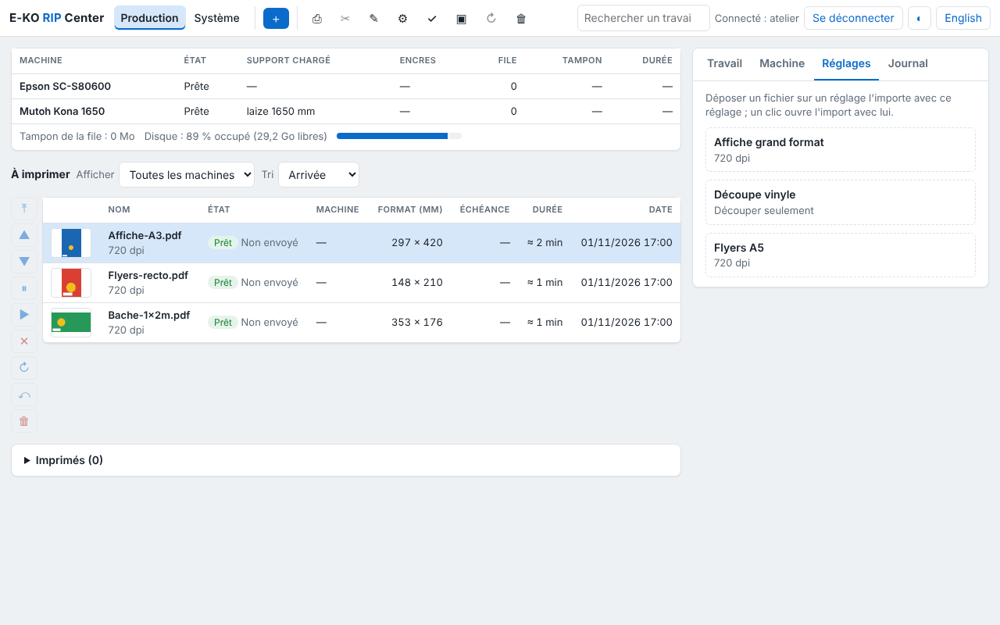

This page is for the person who looks after the server: accounts, backups, updates, shared folders and advanced settings. The commands are typed on the server, in a terminal or over SSH.

## Day to day

```bash
systemctl status eko-rip-serveur        # is the service running?
journalctl -u eko-rip-serveur -f        # live log
sudo systemctl restart eko-rip-serveur  # restart
```

The log records every failed render and every failed output, with the machine, the job and the reason. In the client, the **System** view shows the version, the free disk space and how long jobs are kept.

A restart interrupts the render in progress: the job goes to the "interrupted" failure state, to be restarted with **Retry**. Outputs in the queue stay in the queue; everyone reconnects.

## Accounts

| Action | Command |
|---|---|
| Add an administrator | `sudo -u eko-rip env EKO_RIP_DATA=/var/lib/eko-rip eko-rip-serveur utilisateur ajouter <nom> admin` |
| Add an operator | `… utilisateur ajouter <nom> operateur` |
| List the accounts | `… utilisateur liste` |
| Delete an account | `… utilisateur supprimer <nom>` |

- **Forgotten password** or **role change**: declare the account again with
  `utilisateur ajouter`; the new password and role replace the old ones.
- **5 wrong passwords** block the name for 5 minutes.
- Deleting an account closes its sessions at once. No restart is needed.

## Backing up

**The configuration** (machines, media, prices, saved presets, cutting, spot colours, ICC profiles): in the client, **Administration… › System › Configuration backup › Download the backup**. Keep the file off the server, and make a new backup after every settings change.

**Everything, accounts included**: copy the `/var/lib/eko-rip` folder, with the service stopped. Jobs are large and can be rebuilt from their source files: the configuration and the accounts file (`utilisateurs.json`) are often enough.

**Before every update**, the package copies the configuration by itself into `/var/lib/eko-rip/sauvegardes/` (the last 10 are kept).

### Rebuilding a server

1. Install the server on the new PC ([Install the server](server.md)).
2. Create the administrator account.
3. In the client: **System › Configuration backup › Restore…** and choose the file. Everything is checked before anything is written: a damaged file changes nothing.
4. Recreate the operator accounts.

## Updating

Through the APT repository (server installed as recommended):

```bash
sudo apt update && sudo apt upgrade
```

The data stays in place. The administration interface comes from the server: new features appear there as soon as it is updated. The clients are updated separately (see [Install the clients](clients.md)).

What is new in each version is in the [release notes](https://e-ko.rip/changelog/), with an e-mail subscription.

## Sharing the hot folders

Each saved preset has a folder `/var/lib/eko-rip/entrees/<preset>/`: a file dropped into it goes to the RIP with that preset. To drop files there from the workstations:




```bash
sudo apt install samba
```

Add to the end of `/etc/samba/smb.conf`:

```ini
[eko-rip]
   path = /var/lib/eko-rip/entrees
   writable = yes
   force user = eko-rip
   valid users = eko
```

Then `sudo smbpasswd -a eko` and `sudo systemctl restart smbd`. Workstations open `smb://<server>/eko-rip` (Mac, Linux) or `\\<server>\eko-rip` (Windows).

> [!NOTE]
> Hot folders do not require a RIP account: access is controlled by the Samba share.

## Advanced settings

In `/etc/default/eko-rip-serveur`, then `sudo systemctl restart eko-rip-serveur`.

| Setting | Default | Role |
|---|---|---|
| `EKO_RIP_ADDR` | `0.0.0.0:8640` | listening address and port |
| `EKO_RIP_DATA` | `/var/lib/eko-rip` | data folder |
| `EKO_RIP_MAX_MO` | `8192` | maximum size of a received file, in MB |
| `EKO_RIP_DELAI_S` | `1800` | maximum duration of a render, in seconds |
| `EKO_RIP_RENDUS` | one per core, 4 at most | renders run at the same time (1 to 16) |
| `EKO_RIP_CONSERVATION_JOURS` | `30` | jobs deleted after this number of days (0: never) |
| `EKO_RIP_SEUIL_LIBRE_MO` | `5120` | free space to keep; below it, old jobs are purged |
| `EKO_RIP_SEUIL_ALERTE_MO` | `20480` | threshold for the "disk almost full" alert |
| `EKO_RIP_PLOTTER` | `/dev/kona` | port of the USB cutter |
| `EKO_RIP_EPSON_SNMP` | (empty) | address of the Epson, to read the loaded media |
| `EKO_RIP_ANNONCE` | `1` | `0`: do not announce itself on the network (address to be entered in the clients) |
| `EKO_RIP_CLOUD_NOM` | PC name | name offered for the site on the Cloud |

The full reference (all the settings, the location of each data file) is in the [technical documentation](https://github.com/mvignaud/eko-rip-center/blob/main/docs/en/server-installation.md#settings).

## Where the data is

Everything is in `/var/lib/eko-rip`: one folder per job (`travaux/`), the queue (`file.json`), the machine catalogue (`machines.json`), the media, the presets, the accounts (hashed passwords), the ICC profiles and the hot folders (`entrees/`). Each settings file keeps its previous version (`.prec`): after a power cut, the server picks it up by itself and reports it in **System**.

## Statistics and bug reports

**Anonymous statistics**: the server and the clients send an installation signal (version, system), with no data from the shop or from the files. To stop it: untick **System › Anonymous statistics** (server), **Système › Confidentialité** (Mac; *System › Privacy*) or **Système › Ce poste** (Linux; *System › This computer*); or set `EKO_TELEMETRIE=0` in `/etc/default/eko-rip-serveur`.

**Report a problem**: **Help** menu (Mac; *Aide*), main menu (Linux) or **System › Bug reports** in the administration. The title and description are published on GitHub: put nothing confidential in them. The attached server log and the e-mail stay private. Automatic error reports are sent only after you agree, which is asked the first time you open the administration.
