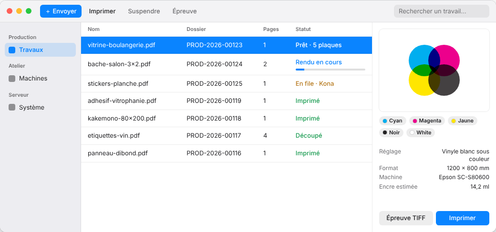

The E-KO RIP Center client is the software for the workstations: you use it to send files, follow
the jobs and the queue, and start printing and cutting. It exists for Mac, Linux and Windows; all
of them talk to the same server and see the same queue.

## What the client does

The window has three panes:

- on the left, the **sidebar**: **Jobs**, **Machines**, **System** (*Travaux*, *Machines*,
  *Système*);
- in the centre, the **job table** (name, folder, pages, status, date), with a search box;
- on the right, the **inspector** for the chosen job: preview, job ticket, ink plates, alerts
  and the actions **Print** (*Imprimer*), **Retry** (*Relancer*), **TIFF proof** (*Épreuve
  TIFF*) and **Delete** (*Supprimer*).

: sidebar, job table, inspector of the chosen job")

You send a file by **dragging it onto the window** (or onto the Dock icon on Mac), or with the
**+ Send** (*+ Envoyer*) button: the client asks which preset to apply and, optionally, the customer, the order and
the quantity. Accepted formats: PDF, PDF-compatible AI, SVG, TIFF, PNG and JPEG. A notification
tells you when the render is ready.

: the file, the preset to apply and the optional job ticket")

The full settings screens (machines, media, colour, cutting, accounts, backup, Cloud) open from
the **Administration…** menu. How to use them is explained in the
[user guide](../../en/usage.md).

## Mac client



**Requirements**: macOS 14 (Sonoma) or later, Apple Silicon or Intel Mac.

1. Download the client: [e-ko.rip/telecharger/mac](https://e-ko.rip/telecharger/mac)
   (`.dmg` file of the latest version).
2. Open the `.dmg` and drag **E-KO RIP Center** into **Applications**.
3. Launch the application. It is signed and checked by Apple: it opens with no warning.
4. At first launch, macOS asks for access to the **local network**: accept, otherwise the
   server is not found.

**Updates**: download the new version and replace the application. The server and the client
are updated separately; a client slightly older than the server keeps working.

**Useful menus**: **Server › Change server…** (*Serveur › Changer de serveur…*),
**Server › Administration…**, **Server › Sign out** (*Serveur › Se déconnecter*),
**Help › Report a problem…** (*Aide › Signaler un problème…*).

## Linux client

, Machines view: the queue of each printer and cutter")

**Requirements**: Ubuntu 24.04 or later, or Debian 13 (GNOME desktop recommended), 64-bit PC.

Install with a single command; the E-KO repository is added to the system:

```bash
wget -qO- https://apt.e-ko.fr/rip/installer | sudo sh
```

The client appears in the applications as **E-KO RIP Center**. It is then updated along with the
rest of the system:

```bash
sudo apt update && sudo apt upgrade
```

**Main menu** (☰ button at the top right): **Administration…**, **Report a problem…**
(*Signaler un problème…*), **Change server…** (*Changer de serveur…*), **Sign out** (*Se
déconnecter*), **About E-KO RIP Center** (*À propos d'E-KO RIP Center*).

## Windows client

")

**Requirements**: Windows 10 or 11, 64-bit.

1. Download the installer: [e-ko.rip/telecharger/windows](https://e-ko.rip/telecharger/windows).
2. Run the `…_x64-setup.exe` file and follow the wizard.
3. The client is not signed yet: if Windows shows "Windows protected your PC", click **More
   info** then **Run anyway** (once per workstation).

> [!NOTE]
> A native Windows client, along the lines of the Mac and Linux clients, is in preparation. In
> the meantime, the Windows client opens the server's interface in its window: all the features
> are there, with a different layout.

## Connecting to the server

At first launch, the connection screen looks for E-KO RIP servers on the local network by itself
and lists them under **Servers found on the network** (*Serveurs trouvés sur le réseau*; name,
address, version): one click is enough.

- **Search again** (*Rechercher à nouveau*) repeats the search (about 3 seconds).
- If nothing appears, enter the address under **Enter an address** (*Saisir une adresse*), for
  example `192.168.1.20:8640`. Discovery does not cross routers or VPNs.
- If the server has accounts, the client then asks for the name and password. The session lasts
  12 hours.

The client remembers the server. To change it: **Change server…**
(<kbd>Cmd</kbd> + <kbd>Shift</kbd> + <kbd>S</kbd> on Mac).

### From outside the shop

If the server is linked to [E-KO RIP Cloud](cloud.md), enter the site's address, for example
`https://atelier.platform.e-ko.rip`, then sign in with your server account. With the **Sign in
to the cloud** button (*Se connecter au cloud*; Mac and Linux clients), the client opens the
browser so you can sign in to your Cloud account, then lists your sites: one click is enough.

## Several servers

A client talks to only one server at a time. To switch from one shop to another (or from the
local network to the Cloud), use **Change server…**: the list offers the servers found and the
address entered last time.
