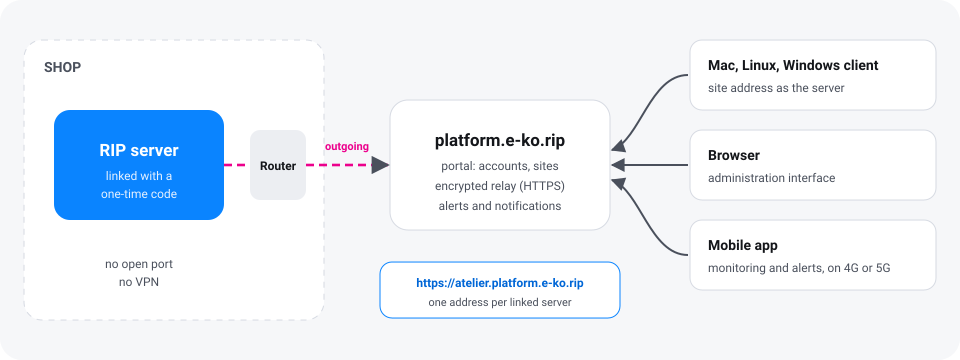
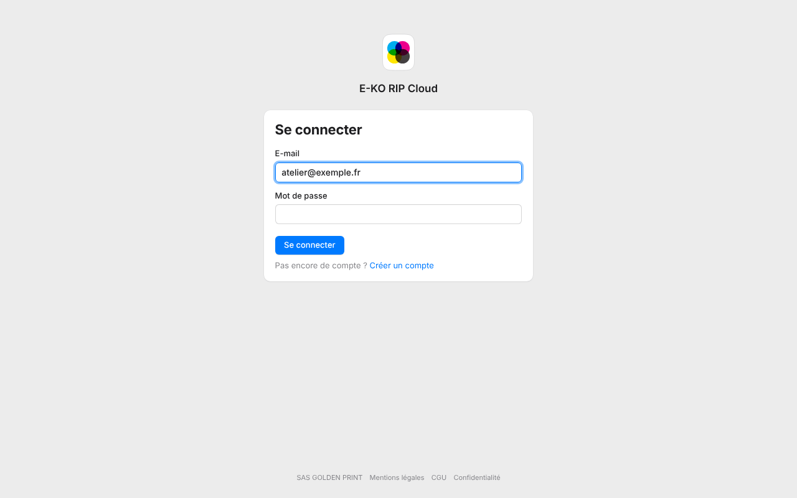
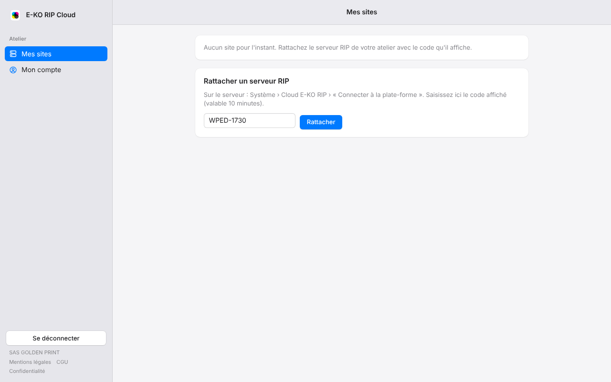
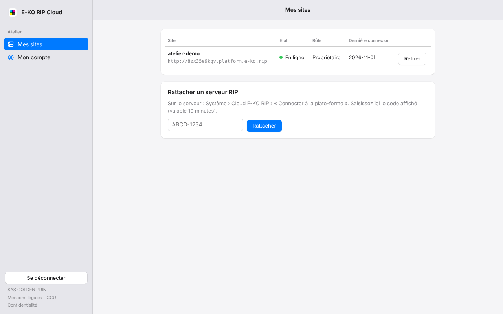
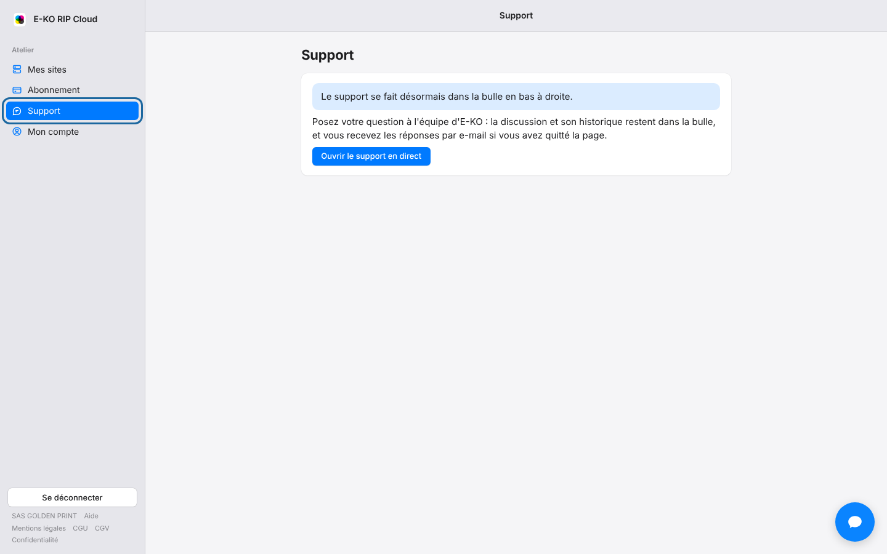
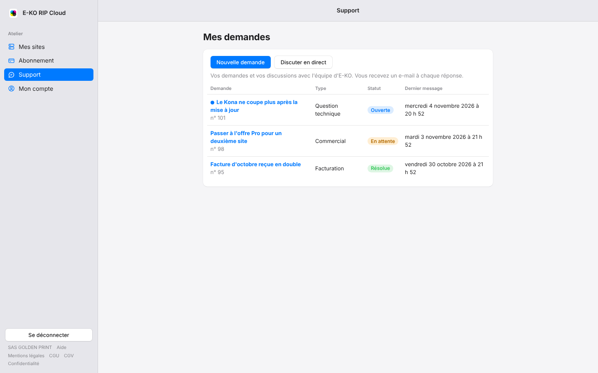

**E-KO RIP Cloud** gives access to the shop's RIP server from outside: from home, at a customer's site, on the road. It works with no VPN and without changing anything on the Internet router. The service is free for a small shop; [paid plans](#plans-and-subscription) cover larger shops.



## What the Cloud is for

Without the Cloud, the RIP server can only be reached on the shop's network. With the Cloud:

- workstations (Mac, Linux, Windows) connect to the server from anywhere;
- the administration interface opens in a browser, just as in the shop;
- the [mobile app](mobile-app.md) follows production away from the shop;
- notifications and e-mails warn you when the server stops responding.

The principle is simple: the shop's server itself opens a connection to the platform. **No port has to be opened** on the router. Remote workstations and phones go through the platform to reach the server.

> [!NOTE]
> The Cloud is optional. The server keeps working normally in the shop, with or without it.

## Creating an account

The platform's portal is at <https://platform.e-ko.rip>.



1. Open <https://platform.e-ko.rip>.
2. Choose **Create an account** (*Créer un compte*).
3. Enter the name (or the shop's name), the e-mail address and a password of at least 10 characters.
4. Accept the terms of use, then confirm.

If the page offers **Google**, **Facebook** or **Suite E-KO**, these buttons also let you sign up without a password. The account created remains a platform account, separate from your E-KO Suite one.

### Confirming the e-mail address

A confirmation e-mail is sent when you sign up with a password.

1. Open the e-mail sent by **E-KO RIP Cloud** (`no-reply@e-ko.fr`).
2. Click the confirmation link, valid for 24 hours.
3. Click the button on the page to confirm.

Until the address is confirmed, a banner says so on **My sites** (*Mes sites*) and **My account** (*Mon compte*). It offers **Resend the e-mail** (*Renvoyer l'e-mail*). Linking a server is refused until the address is confirmed. The rest of the portal works.

An account created with Google or with E-KO Suite is confirmed automatically.

> [!TIP]
> If the e-mail does not arrive, look in the spam folder, then ask for a new one from the banner.

## Linking a RIP server

Linking takes two steps: a code on the server, then entering that code on the portal. Allow two minutes.

### Before you start

The server must have **at least one user account**. Without an account, access to the server is open on the local network, and the Cloud refuses to open so as not to leave the shop open to everyone.

To create an account, see [Run the server](administration.md#accounts). The server must also have Internet access (see [Install the server](server.md)).

### Step by step

1. Open the RIP server's administration interface, with an administrator account.
2. Go to **System › E-KO RIP Cloud**.
3. Click **Connect to the platform**. The server shows a short code, such as `KXRT-4821`, valid for **10 minutes**.
4. On the portal, sign in with your account.
5. Go to **My sites**, section **Link a RIP server** (*Rattacher un serveur RIP*).
6. Enter the code, then click **Link** (*Rattacher*).



> [!TIP]
> The server also shows a link: opening it leads straight to the code entry page.

A few seconds later, the server is linked. The **System › E-KO RIP Cloud** screen shows **Connected: reachable remotely** and displays the **Remote address**. The account that entered the code becomes the owner of the site.



The portal lets you link up to 10 sites per account.

> [!NOTE]
> After a network outage, the server reconnects by itself, with no action needed.

## Using remote access

Each site has its own address:

```
https://<site>.platform.e-ko.rip
```

It is shown in **System › E-KO RIP Cloud** on the server, and in **My sites** on the portal. It is used in three cases.

### In a desktop client

1. Open the client (see [Mac](clients.md#mac-client), [Linux](clients.md#linux-client) or [Windows](clients.md#windows-client)).
2. Enter the site's address in place of the server's local address.
3. Sign in with an account of the RIP server.

### In a browser

1. Open the site's address.
2. Sign in with an account of the RIP server.

The administration interface works just as in the shop.

### In the mobile app

Enter the site's address in the **Server** field, or use **Sign in to the cloud** (see below). Details in [Mobile app](mobile-app.md).

> [!NOTE]
> The accounts used remotely are those of the RIP server, the ones in [Run the server](administration.md#accounts). The platform account is used for the portal and for **Sign in to the cloud**.

## Signing in to the cloud from the apps

The Mac, Linux and mobile apps have a **Sign in to the cloud** button (*Se connecter au cloud*) on their sign-in screen. It saves you from entering an address and a second password.

1. Click **Sign in to the cloud**. The browser opens on the platform.
2. Sign in with your account (password, Google, Facebook or E-KO Suite).
3. Authorise the app when the portal asks.
4. Go back to the app: it shows the list of the account's sites, online or not.
5. Choose the site you want.

Rights in the app follow the account's role on the site: an owner or an administrator is a RIP administrator, an operator is an operator, a read-only account cannot change anything.

An app's access stays valid for about 180 days. Each time a new app is connected, a security e-mail is sent to the account holder.

### Disconnecting an app

1. Sign in to the portal.
2. Open **My account**.
3. In **Connected apps** (*Apps connectées*), click **Disconnect all apps** (*Déconnecter toutes les apps*).

In the app itself, **Sign out of the cloud** (*Se déconnecter du cloud*) removes the device's access.

> [!NOTE]
> Sharing a site with other accounts (colleagues, contractors) with an operator or read-only role is planned for soon. For now, the owner of a site is the account that linked it.

## E-mails from the platform

The platform writes from **E-KO RIP Cloud**, address `no-reply@e-ko.fr`. There is nothing to set up. Do not reply to these messages.

| E-mail | When |
|---|---|
| Forgotten password | On request, with a link valid for 1 hour, usable once only. |
| Address confirmation | When signing up with a password, link valid for 24 hours. |
| Site offline | The server has been unreachable for 15 minutes. |
| Site back online | The server answers again, only if the "offline" alert was sent. |
| New app connected | An app has just connected to the account. |
| Weekly summary | Every Monday around 8 a.m., for each site. |

Site offline alerts go to the site's owners and administrators. At most one alert is sent per site per hour.

The weekly summary gives, for each site: the number of outages, the total time offline, the longest outage, the alerts sent and the apps connected during the week.

### Choosing which e-mails to receive

1. Open **My account** on the portal.
2. Tick or untick **Receive alerts** and **Receive the weekly summary** (*Recevoir les alertes*, *Recevoir le résumé hebdomadaire*).

Both boxes are ticked by default. The "new app connected" e-mail is always sent: it is a security measure. Live support replies arrive by e-mail when the page is closed, whatever these boxes say.

### Forgotten password

1. On the sign-in page, click **Forgot your password?** (*Mot de passe oublié ?*).
2. Enter the account's e-mail address.
3. Open the e-mail you receive and click the link within the hour.
4. Choose a new password.

For security reasons, the page answers the same way whether the address exists or not. The new password closes all of the account's sessions and disconnects its apps.

## Notifications

The same events as the e-mail alerts can arrive as notifications: **site offline**, **site back online** and **new app connected**. They follow the **Receive alerts** box.

### In the browser

After the first sign-in to the portal, the **My sites** page offers **Receive alerts on this computer?** (*Recevoir les alertes sur cet ordinateur ?*)

1. Click **Enable** (*Activer*).
2. Allow notifications when the browser asks.

The **Later** button (*Plus tard*) postpones the choice, and the question does not come back afterwards. To decide later:

1. Open **My account**.
2. In the **Notifications on this device** card (*Notifications sur cet appareil*), click **Enable browser notifications** (*Activer les notifications du navigateur*).
3. To stop on one browser, click **Remove** (*Retirer*) next to it.

Notifications arrive even when the portal page is closed, as long as the browser is running.

### In the Mac, Linux and mobile apps

The apps ask for permission to show notifications right after the first sign-in to the cloud. Just accept. If permission was refused, restore it in the system or phone settings.

## Live support

A question, a problem, an idea? You can reach the E-KO team from the portal, with no other account to create, in the blue live support bubble at the bottom right of every portal page once signed in. The **Support** link in the sidebar opens the **My requests** (*Mes demandes*) page; its **Chat live** (*Discuter en direct*) button opens the same bubble.



1. Click the blue bubble at the bottom right, or **Chat live** (*Discuter en direct*) on the **Support** page.
2. Write your message and send it. You can attach a screenshot or a log.
3. The team's replies show up in the bubble. Closing the bubble does not end the conversation.

No need to introduce yourself: the account's name, e-mail address and company come with the message, and the team sees which account it is from. The history of your conversations stays in the bubble. If the page is closed when the team replies, the reply also arrives by e-mail.

When you sign out of the portal, the conversation is removed from this browser: the next person using the computer does not see it.

### My requests

For a topic that needs follow-up (a breakdown, an invoice, a quote), the **Support** page lists the account's written requests: subject, number, type, status (**Open**, **Waiting**, **Resolved** — *Ouverte*, *En attente*, *Résolue*) and date of the last message. A blue dot flags an unread reply.



1. Click **New request** (*Nouvelle demande*), choose the type (technical question, billing, sales, other) and the urgency (normal, high, blocking), write the subject, choose what the request is about, then describe the problem.
2. Attach files if needed: 5 at most, 10 MB each (images, PDFs, `.log`/`.txt`/`.json` logs, `.zip` archives).
3. Click **Send request** (*Envoyer la demande*). The request thread opens: your messages on the right, the team's on the left with the first name of the person replying.
4. Reply in the same thread, then click **Mark as resolved** (*Marquer comme résolue*) once the problem is fixed. A new reply reopens the request.

Each reply from the team is announced by the e-mail "Nouvelle réponse à votre demande n° …" (new reply to your request) with a link to the request; the reply text is not included in the e-mail. Another e-mail tells you when the request becomes **Resolved**. Only the account's own requests are visible.

> [!NOTE]
> Requests opened before live support arrived (`TKT-…`) stay readable for 30 days on the **Support** page, read-only. To follow one up, open a new request or write in the bubble and quote its reference.

## Managing your account

**My account** brings together:

- the name, the e-mail address and the sign-up date;
- the linked sign-in methods (password, Google, Facebook, E-KO Suite); an existing account is linked from **My account** with **lier mon compte Suite E-KO** (*link my E-KO Suite account*);
- the e-mail boxes and the **Notifications on this device** card;
- the list of **Connected apps**;
- account deletion.

### Changing the language

The portal is available in French, English, Spanish, Italian and German. On a first visit it follows the browser's language (English if that language is not offered). To change it, click **FR**, **EN**, **ES**, **IT** or **DE** at the bottom of any page: the page reloads in the chosen language, which this browser remembers for a year. Once you are signed in, the choice also applies to the platform's e-mails. The terms and conditions, the legal notice and the privacy policy stay in French, the only binding version.

### Deleting your account

1. Open **My account**.
2. Go to the **Delete my account** section (*Supprimer mon compte*).
3. Confirm.

> [!WARNING]
> Deletion erases the account, its rights and **the sites it owns**. Their remote access stops immediately. The shop's RIP server itself is not touched: it stays usable on site.

## Unlinking a server

Unlinking cuts remote access, without touching the server or its data.

### From the server

1. Open **System › E-KO RIP Cloud**.
2. Click **Unlink from the platform**.
3. Confirm.

Remote access stops immediately. To restore it, link the server again with a new code.

### From the portal

1. Open **My sites**.
2. Click **Remove** (*Retirer*) next to the site, then confirm.

Only the owner can remove a site.

## Plans and subscription

The Cloud stays **free for a small shop** (1 site, 1 printer and 1 cutter). Paid plans are available for shops with more machines or several sites. Prices are **excluding VAT**, and the number of users is **unlimited** on every plan. Paid plans are for businesses.

| Plan | Price (excl. VAT) | Sites | Machines | Online backups | Storage |
|---|---|---|---|---|---|
| Free | €0, no time limit | 1 | 1 printer + 1 cutter | latest version | 1 GB |
| Per machine | €6 / month per machine beyond the free ones | 1 | as needed | 30 versions | 5 GB per machine |
| Atelier | €19 / month | 1 | up to 5 (+€4 / month per extra machine) | 90 days | 25 GB |
| Pro | €49 / month | 3 | up to 15 (+€4 / month per extra machine) | 1 year, restore to another site | 100 GB |
| Enterprise | on quote | | | | |

- **Annual subscription**: 10 months paid for 12 months of service.
- **Trial**: if your first paid subscription is the Atelier plan, you get a 30-day trial, with no invoice before it ends (a card is only checked, not charged). The trial is offered once per account; it is shown when you subscribe.
- **Machines counted**: those your RIP server declares to the platform itself. There is nothing to type in; the **Subscription** page lists them site by site.
- **Enterprise**: for larger needs, write to contact@e-ko.rip.
- Full terms are in the [terms of sale](https://platform.e-ko.rip/cgv) (in French).

### Subscribing to a plan

1. Open **Subscription**, then **See the plans**.
2. Choose the plan and the billing period (monthly or annual).
3. Fill in the company. Entering the SIREN or SIRET fills in the company name and address automatically. Add the contact, the billing e-mail address, the phone number (pick the country, shown with its flag and dialling code, then type the number as you usually would) and, if needed, a purchase order number.
4. If you have a code, enter it in the single **Promo or partner code** field. It is checked straight away and its conditions are shown.
5. Tick the acceptance of the terms of sale, then choose the payment method. Everything happens on the page, without leaving it:
   - **Bank card**: enter the card in the secure field. If the bank asks for confirmation (3-D Secure), it appears on the page.
   - **SEPA direct debit**: enter the IBAN. The mandate is shown on the page; a code is sent by SMS to the mobile number given, and you sign the mandate electronically by entering that code.

An e-mail confirms the subscription, then each invoice. Invoices are issued by **GOLDEN PRINT**; all e-mails come from **E-KO RIP**.

### Managing your subscription

The **Subscription** page lets you:

- see your **usage**: machines and sites counted, backup space used;
- download **invoices** as PDF;
- **change plan** or billing period: the change is immediate and a new period starts at the price of the new plan;
- change the **payment method** (new card or new mandate);
- **cancel**: cancellation takes effect at the end of the current period, which is not refunded, then the account returns to the Free plan.

If a payment fails, an e-mail says so and further attempts are made, with reminders. If it is not settled, the subscription is cancelled and the account returns to the Free plan.

### When the fleet exceeds the plan

When there are more sites or machines than the plan includes:

1. An **e-mail** warns the owner and the site administrators.
2. A **14-day grace period** lets you subscribe to a suitable plan or remove the extra machines or sites.
3. After that, **remote access** to the sites concerned is **suspended** until the situation is put right.

> [!NOTE]
> Work in the shop is never affected: the RIP server keeps printing and cutting normally. Only remote access is suspended.

## Online backups

The RIP server can send the platform a backup of its **configuration**: it is the same archive as **System › Backup** (machines, settings, ICC profiles...). It contains **neither jobs nor accounts**. Backups are encrypted and hosted in France.

- **When**: every night (if the configuration changed), about 2 minutes after a change, and on demand by an administrator.
- **How long**: depending on the plan, the latest version (Free), 30 versions (Per machine), 90 days (Atelier) or 1 year (Pro). The most recent one is always kept.
- **Space alerts**: the owner is warned when the quota reaches 80%, then 100%. At 100%, new backups are refused until space is freed or the plan changes.
- **Failure alert**: if no nightly backup arrives for two nights, an e-mail warns the owner and the site administrators.

### Restoring a backup

The site owner and administrators can restore from the portal.

1. Open **My sites**, then the site's **Backups**.
2. Find the version you want (date, reason, size). It can also be downloaded.
3. Click **Restore** and confirm. The RIP server's configuration is replaced by that of the backup.

With the **Pro** plan, a backup can also be restored to **another site** of the same owner.

> [!WARNING]
> A restore replaces the server's current configuration. If in doubt, download a backup of the current state first.

## What never goes through the Cloud

Some functions stay reserved for the shop, even with the Cloud:

- the ERP bridge and its settings;
- forwarding jobs between two RIPs;
- linking and unlinking the Cloud itself: these are done only from the shop.

The server refuses these requests when they arrive through the Cloud. For safety, it also refuses them when no account is declared on the server.

## Security in brief

- No port is open in the shop: the server connects to the platform, never the other way round.
- Each site has its own address, isolated from those of other sites and from the portal.
- An account's password is blocked for 5 minutes after 5 failures.
- The portal passes only the RIP server's session to the shop, never the platform account's information.

## Frequently asked questions

### The site is "offline"

The shop's RIP server is not linked to the platform.

1. Check on site that the server is switched on and has Internet access.
2. Open **System › E-KO RIP Cloud**. The message **Platform unreachable** points to an Internet connection problem.
3. Wait a minute: after an outage, the server reconnects by itself.

If the alert is enabled, a "back online" e-mail confirms recovery.

### The code has expired or is refused

The code is valid for only 10 minutes. On the server, click **Connect to the platform** again to get a new one. If the portal refuses the link, check that the account's e-mail address is confirmed.

### The Cloud will not open: "at least one account"

Create an account on the server (see [Run the server](administration.md#accounts)), then try again.

### I forgot my password

Use **Forgot your password?** on the sign-in page (see above). For a RIP server account, see [Run the server](administration.md#accounts).

### My remote access is suspended

The plan has been exceeded for more than 14 days (too many machines or sites). Open **Subscription**: subscribing to a suitable plan or removing the extra machines restores access. Work in the shop was not interrupted.

### I cannot find my online backups

They are in **My sites › Backups**. If the latest one is old, check that the site is online and that the plan's quota is not full.

### I do not receive the e-mails

Look in the spam folder. Check the account's address in **My account** and the boxes ticked. The e-mails come from `no-reply@e-ko.fr`.

### I cannot see the support bubble

The bubble only appears on portal pages once signed in. An ad blocker or a privacy extension can hide it: allow `platform.e-ko.rip` in the extension, then reload the page. Otherwise, write to <contact@e-ko.rip>.

## Legal information

- Terms of use: <https://platform.e-ko.rip/cgu>
- Terms of sale (paid plans): <https://platform.e-ko.rip/cgv>
- Privacy policy: <https://platform.e-ko.rip/confidentialite>
- Legal notice: <https://platform.e-ko.rip/mentions-legales>

A question? Write to contact@e-ko.rip.
