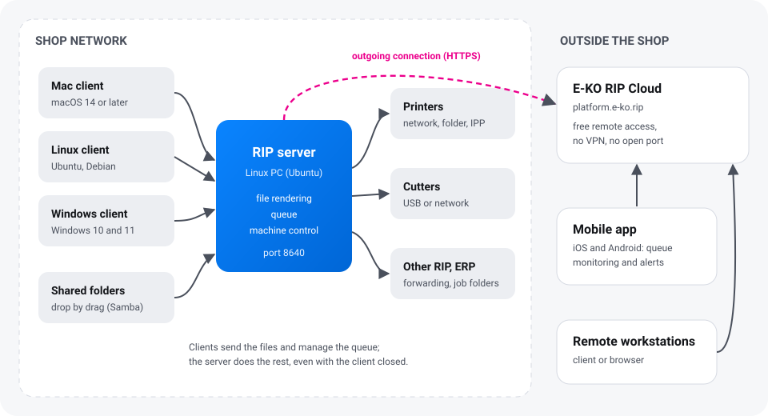
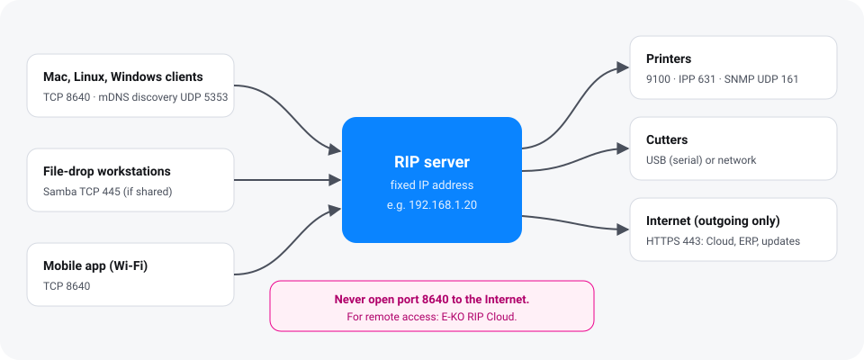

This page introduces the parts of E-KO RIP Center and the order in which to install them. Allow
one hour for a simple shop: one server, one or two workstations, one printer and one cutter.

## The parts of the RIP

| Part | Where | Role |
|---|---|---|
| **RIP server** | a Linux PC in the shop, switched on all the time | receives the files, calculates the renders, keeps the queue, drives the machines |
| **E-KO RIP Center client** | each workstation (Mac, Linux, Windows) | sends the files, follows the jobs, starts printing and cutting |
| **Mobile app** | iOS or Android phone | follows the queue and the machines, receives alerts (empty cartridge, machine unreachable…) |
| **E-KO RIP Cloud** | online service, `platform.e-ko.rip` | gives access to the server from outside, with no VPN and no open port |
| **Administration interface** | in the client (**Administration…**) or through the Cloud in a browser | machine settings, media, colour, accounts, backup |

A browser opened on the server's address inside the shop only shows a **status page** (version,
machines, address to enter in the client): the full interface is reserved for the clients.

## Set up a print shop in five steps

### 1. Prepare the server

Choose a 64-bit (x86) PC that will stay switched on, preferably with an SSD reserved for the
data, connected by cable and on a UPS. Give it a **fixed IP address** on the router. Details:
[choosing the server PC](server.md#choosing-the-server-pc).

### 2. Install the server

On Ubuntu 24.04 or 26.04 LTS, add the E-KO repository then install the `eko-rip-serveur`
package. The service starts by itself and restarts with the PC. Details:
[installing from the APT repository](server.md#installing-from-the-apt-repository).

### 3. Create the accounts

As long as no account exists, any computer on the network can do everything, and the screen
shows this in red. Create at least one **administrator** account, then one **operator** account
per person. Details: [accounts and roles](server.md#creating-the-accounts).

### 4. Install the clients

On each workstation, install the client then choose the server in the **Servers found on the
network** (*Serveurs trouvés sur le réseau*) list. Details: [install the clients](clients.md).

### 5. Declare the machines

In the client, open **Administration…**, then **System › Machines**: add each printer and each
cutter, its connection (network, USB, folder) and its media. Every model has its own page in the
[machine guide](../../en/machines.md).

> [!TIP]
> Before the first real production run, send a small test PDF, check its preview and its plates
> in the inspector, then print it on an offcut.

## What next

- [Send a first job](../../en/usage.md#sending-a-job) and learn the queue.
- Install the [mobile app](mobile-app.md) to be warned of a breakdown.
- Link the server to [E-KO RIP Cloud](cloud.md) to reach it from outside.
- Schedule a [configuration backup](administration.md#backing-up).

## What the server needs on the network

| Direction | Port | For |
|---|---|---|
| Workstations → server | TCP **8640** | clients, mobile app inside the shop, forwarding between RIPs |
| Workstations ↔ server | UDP 5353 (mDNS) | automatic discovery of the server by the clients |
| Workstations → server | TCP 445 | shared hot folders (Samba), if you share them |
| Server → printers | TCP 9100, 631 (IPP), UDP 161 (SNMP) | sending jobs, ink levels, loaded media |
| Server → Internet | TCP 443 (HTTPS, outgoing) | updates, E-KO RIP Cloud, ERP |

> [!WARNING]
> Never open port 8640 to the Internet: the connection is not encrypted. To work remotely, use
> [E-KO RIP Cloud](cloud.md).
