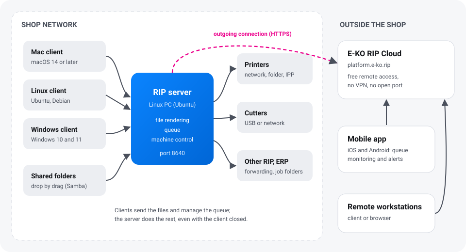

E-KO RIP Center is a free, open-source wide-format printing RIP. A **server** installed on a Linux
PC in the print shop receives the files, calculates the renders and drives the printers and
cutters. Workstations connect to it with the Mac, Linux or Windows **client**; the **mobile app**
follows production; **E-KO RIP Cloud** gives access to the shop from outside.

## Where to start

| I want to… | Read |
|---|---|
| Understand the whole system and set up a print shop step by step | [Getting started](getting-started.md) |
| Install the server on a Linux PC | [Install the server](server.md) |
| Install the software on my Mac, Linux PC or Windows PC | [Install the clients](clients.md) |
| Follow production on my phone | [Mobile app](mobile-app.md) |
| Reach the shop from home or from a customer's site | [E-KO RIP Cloud](cloud.md) |
| Send a file, print, cut, make a proof | [User guide](../../en/usage.md) |
| Connect and set up a machine | [Machines](../../en/machines.md): printers, cutting plotters, cutting tables |
| Manage accounts, back up, update | [Run the server](administration.md) |
| Understand an error message | [Troubleshooting](troubleshooting.md) |

## What to know first

- **All the work is done on the server.** Clients send the files and show the queue; once a file
  has been sent, you can close the client: rendering and printing carry on.
- **One server for the whole shop.** Every workstation, Mac, Linux or Windows, sees the same
  queue and the same machines.
- **The server stays in the shop.** It is never exposed to the Internet; to reach it from
  outside, use [E-KO RIP Cloud](cloud.md), which is free.
- **Free software.** The code is public under the AGPL-3.0 licence on
  [GitHub](https://github.com/mvignaud/eko-rip-center); there is no licence to buy and no limit
  on the number of workstations.

> [!TIP]
> Trade terms (plate, roll width, proof, registration…) are explained in the
> [glossary](../../en/glossary.md).

## Getting help

- In the client: **Report a problem…** (*Signaler un problème…*; in the **Help** menu (*Aide*)
  on Mac, in the main menu on Linux) sends a description and the useful information to the team.
- By e-mail: [contact@e-ko.rip](mailto:contact@e-ko.rip).
- What is new in each version: [release notes](https://e-ko.rip/changelog/).

This documentation follows the latest published version. It is updated whenever the RIP, the
clients, the mobile app or the Cloud change.
