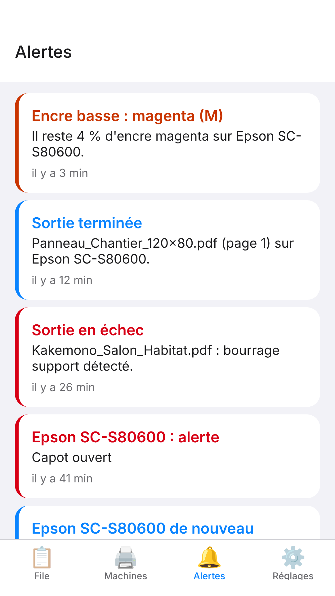

The **E-KO RIP** app lets you follow the shop from a phone: print queue, machine status, ink levels and alerts. It warns you as soon as a machine stops with an error, even when the phone is in your pocket. It works on iPhone and Android.

> [!NOTE]
> The app is for **monitoring**. It sends no files and does not set up printing or cutting: those operations are still done from a workstation (see [Clients](clients.md#mac-client)).

## What the app does

- See the print queue of each machine, with the outputs in progress first.
- Start, pause, stop, retry or move an output to the front.
- Check the status of each machine: printing, cutting, idle, unreachable.
- Check the level of each ink and the length of media left on the roll.
- Read the history of the latest alerts.
- Receive notifications for errors, nearly empty ink or failed outputs.

## Installing the app

The app will soon be available on the App Store and on Google Play. The download link and the news are announced on the app page: <https://e-ko.rip/app/>.

> [!NOTE]
> You do not need an E-KO account to install the app. It connects only to the shop's RIP server.

## Connecting to a server

The app asks which RIP server to connect to. There are two cases: in the shop with the local address, or remotely with E-KO RIP Cloud.

### In the shop: local address

The phone must be on the shop's Wi-Fi network.

1. Open the app.
2. In the **Server** field (*Serveur*), enter the address of the RIP server, for example `http://192.168.1.20:8640`. This is the address used in the desktop clients (see [Install the server](server.md)).
3. Tap **Continue** (*Continuer*).
4. If the server asks for an account, enter the user name and password, then tap **Sign in** (*Se connecter*).

An **Operator** (*Opérateur*) account is enough to follow the queue and act on outputs. Accounts are managed in the server administration (see [Run the server](administration.md#accounts)).

The name and password are kept in the phone's secure storage. The app reuses them to reopen the session when it expires, after 12 hours or after a server restart.

### Away from the shop: E-KO RIP Cloud

The Cloud lets you reach the shop's server from outside, with no VPN. The server must already be linked to the platform (see [E-KO RIP Cloud](cloud.md)).

There are two ways to do it:

- Enter the site's remote address in **Server**, in the form `https://<site>.platform.e-ko.rip`, then an account of the RIP server.
- Tap **Sign in to the cloud** (*Se connecter au cloud*) under the "away from the shop" note.

With **Sign in to the cloud**:

1. Tap **Sign in to the cloud**. The phone's browser opens on the platform.
2. Sign in with the platform account, then authorise the app.
3. The app opens on the **Your sites** screen (*Vos sites*), which lists the account's sites, online or not.
4. Tap the site you want. No second password is requested.

The role shown in the app comes from the one given to the account on the site. Access stays valid for about 180 days.

To sign out of the cloud, tap **Sign out of the cloud** (*Se déconnecter du cloud*) on the **Your sites** screen. You can also disconnect the apps from **My account** (*Mon compte*) on the portal (see [E-KO RIP Cloud](cloud.md)).

## The app's tabs

The app has four tabs: **Queue**, **Machines**, **Alerts** and **Settings** (*File*, *Machines*, *Alertes*, *Réglages*).

### Queue

The **Queue** tab lists the outputs of each machine. Outputs in progress and waiting come first, then the recently finished outputs.

Each output has a status: **In progress** (*En cours*), **Waiting** (*En attente*), **Suspended** (*Suspendue*), **Finished** (*Terminée*), **Failed** (*Échec*) or **Cancelled** (*Annulée*). If an output fails, the error message is shown under it. The elapsed time and the estimated time are shown when they are known.

To act on an output:

1. Tap the output.
2. Choose the action you want in the list.
3. Confirm if the app asks you to.

The actions offered depend on the output's status:

| Output status | Possible actions |
|---|---|
| Waiting | **Pause**, **Move to front** (*Passer en tête*), **Stop** |
| Suspended | **Start** (*Lancer*) or **Resume** (*Reprendre*), **Move to front**, **Stop** |
| Finished or failed | **Retry** (*Relancer*; creates a new, identical output) |
| Nested in a sheet | No action |

> [!WARNING]
> **Pause** and **Stop** only act on an output that has not yet been sent to the machine. A print already sent to the machine cannot be stopped from the app. To interrupt it, use the machine itself.

### Machines

The **Machines** tab shows one card per machine:

- the status: **Printing** (*En impression*), **Cutting** (*En découpe*), **Idle** (*En attente*) or **Unreachable** (*Injoignable*);
- the current output;
- the level of each ink, with low levels highlighted;
- the length of media left on the roll;
- the current alerts (cover open, end of roll…);
- the time of the last reading.

The server polls the Epson machines about once a minute. The values shown are therefore at most a few moments old.

### Alerts

The **Alerts** tab keeps the last 200 events: machine alerts, nearly empty ink, failed outputs, unreachable machine. A badge marks events not yet seen.

### Settings

The **Settings** tab shows:

- the server, the user and the role (**Administrator** or **Operator**; *Administrateur*, *Opérateur*);
- the notification switches;
- the **Send a test notification** button (*Envoyer une notification d'essai*);
- the **Sign out** button (*Se déconnecter*) and the app's version number.

## Notifications

Notifications reach you even when the app is closed.

### Turning notifications on

1. Accept the permission requested by the phone at first sign-in.
2. Open the **Settings** tab and check that **Notifications** is on.
3. Tap **Send a test notification**: it should arrive within a few seconds.

In **Settings**, two switches define what you receive:

- **Machine errors** (*Erreurs machine*): alerts, ink, failures, unreachable machine.
- **Print finished** (*Fins d'impression*): a notification for every finished print. This option is off by default.

### Events that notify

| Event | When |
|---|---|
| Machine alert | A new alert appears (cover open, media used up…). Ordinary states (ready, printing, warming up, standby) do not notify. |
| Nearly empty ink | An ink drops to 5% or less. |
| Empty cartridge | An ink reaches 0%. |
| Machine unreachable | Three readings in a row without an answer, then a notification when it answers again. |
| Failed output | A print or a cut fails. |
| Failed render | The render of a job fails. |
| Print finished | Only if **Print finished** is on. |

After a server restart, no burst of notifications is sent: the server simply picks up the current state.

### Cloud notifications

When the app is connected to the cloud, it asks for notification permission right after the first sign-in. It then also receives the platform's notifications: site offline, site back online, new app connected to the account. These notifications follow the **Receive alerts** box (*Recevoir les alertes*) in **My account** on the portal (see [E-KO RIP Cloud](cloud.md)).

A phone stays registered as long as the app is opened at least once every 30 days.

> [!TIP]
> If no notification arrives, check the permission in the phone's settings, then the **Notifications** switch in the app. Signing out then back in renews the phone's registration with the server.

> [!NOTE]
> Machine notifications are sent by the RIP server. It must therefore have Internet access.

## Demo mode

Demo mode shows the app with made-up data, with no server and no connection.

1. On the sign-in screen, tap **Try demo mode** (*Essayer le mode démo*).
2. Browse the tabs: nothing is saved and nothing is sent.
3. To leave, open **Settings** and tap **Leave demo mode** (*Quitter le mode démo*).

## Privacy

The app talks only to the shop's RIP server and, if it is used, to the E-KO RIP Cloud platform. The publisher receives no account, no advertising and no audience measurement.

- Credentials are kept in the phone's secure storage and sent only to the server you chose.
- For notifications, a phone token is passed to the server; the messages then go through the Expo notification service, then through Apple or Google.
- Signing out deletes the credentials from the phone and removes the phone from the notification list.

The full policy is published at <https://e-ko.rip/app/confidentialite/>.

## Frequently asked questions

### Which address should I enter to connect?

In the shop, the server's local address (for example `http://192.168.1.20:8640`). Away from the shop, the site's address on the cloud (`https://<site>.platform.e-ko.rip`) or the **Sign in to the cloud** button. See [E-KO RIP Cloud](cloud.md).

### The app cannot reach the server

1. Check that the phone is on the shop's Wi-Fi, if you are using the local address.
2. Check the address you entered, with no spaces.
3. Away from the shop, use the cloud: the local address can only be reached on site.

If the problem persists, see [Troubleshooting](troubleshooting.md).

### The site is "offline" in the list

The shop's RIP server is not linked to the platform: it is switched off or has no Internet. Check the server on site (see [E-KO RIP Cloud](cloud.md)).

### I do not receive notifications

Check the permission in the phone's settings, the **Notifications** switch in **Settings**, then that the RIP server is up to date. Signing out and back in renews the registration.

### Can I send a file to print from the phone?

No. Files are sent from a workstation or from the browser (see [Install the clients](clients.md#mac-client)).

### Why does printing carry on after **Stop**?

**Stop** cancels a waiting or suspended output. A print that has already gone to the machine cannot be interrupted from the app.

### A question, a problem?

Write to contact@e-ko.rip.
