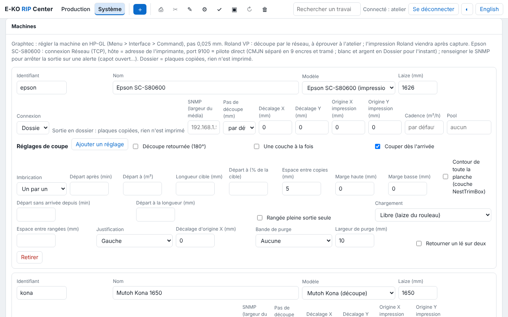

The server is the heart of the RIP: it runs on Linux on a PC in the shop, receives the files from
the workstations, calculates the renders and drives the machines. This page covers choosing the
PC, installation, accounts and first start-up.

## Choosing the server PC

The server is the computer that must never stop. Rendering the files (Ghostscript) is the
heaviest task.

| | Trials, small volume | Shop in production |
|---|---|---|
| **System** | Ubuntu 24.04 or 26.04 LTS, Debian 13 | Ubuntu 26.04 LTS |
| **Processor** | 2 cores, x86 64-bit | 4 cores or more |
| **Memory** | 16 GB | 16 to 32 GB |
| **Data disk** | 500 GB | dedicated SSD of 1 TB or more |
| **Network** | cable | cable, fixed IP address |

The packages are built for **x86 64-bit (amd64)** PCs. More memory and more cores shorten the
renders of banners of several tens of m² at high resolution.

**Disk**: a render takes about **1 GB per m² at 600 dpi** (a quarter of that at 300 dpi, four
times more at 1,200 dpi). An SSD reserved for the data folder (`/var/lib/eko-rip`), separate from
the system disk, stops a large render from filling the system. Mount it before the first
start-up. Below 5 GB free, the server deletes the oldest inactive jobs and refuses a job that
would not fit; below 20 GB, every new job carries the "disk almost full" alert.

**UPS**: plug the server, the switch and, if possible, the router into it. A power cut stops the
render in progress (the job has to be restarted) and any output being sent (to be redone). The
settings files, however, survive the cut.

**Fixed IP addresses**: reserve them on the router for the server, the network printers and the
network cutters.

> [!TIP]
> The full requirements, with a comparison, are also on the
> [Requirements](https://e-ko.rip/prerequis/) page of the website.

## Installing from the APT repository

This is the recommended method: the server is then updated along with the rest of the system.
On the server PC, in a terminal:

```bash
# 1. Add the E-KO key and repository (once)
sudo wget -qO /usr/share/keyrings/eko-rip.gpg https://apt.e-ko.fr/rip/eko-rip.gpg
echo "deb [signed-by=/usr/share/keyrings/eko-rip.gpg] https://apt.e-ko.fr/rip ./" | sudo tee /etc/apt/sources.list.d/eko-rip.list

# 2. Install the server
sudo apt update
sudo apt install eko-rip-serveur
```

The package installs Ghostscript, creates the `eko-rip` system account and starts the
`eko-rip-serveur` service, which restarts by itself with the machine. Jobs are stored in
`/var/lib/eko-rip`.

Check that it is running:

```bash
systemctl status eko-rip-serveur
```

Then open `http://<server-address>:8640` in a browser on another computer: the status page
should appear.


> [!NOTE]
> A PC that is both server and workstation can use the client installation script
> (`wget -qO- https://apt.e-ko.fr/rip/installer | sudo sh`), which adds the same repository: you
> then only need to run `sudo apt install eko-rip-serveur`.

### Without the repository: the .deb package

The `eko-rip-serveur_<version>-1_amd64.deb` package is also attached to each release on
[GitHub](https://github.com/mvignaud/eko-rip-center/releases). Install it with:

```bash
sudo apt install ./eko-rip-serveur_<version>-1_amd64.deb
```

Updates are then done by hand, in the same way.

### Ubuntu 26.04

Since version 0.31.0, the package allows Ghostscript to read the RIP's jobs despite the AppArmor
confinement of Ubuntu 26.04. An older version fails on every render ("Permission denied"):
update.

## Creating the accounts

Without accounts, access is open to the whole network and the screen shows this in red. The
Cloud and the mobile app require accounts.

Create the first account (administrator) on the server:

```bash
sudo -u eko-rip env EKO_RIP_DATA=/var/lib/eko-rip eko-rip-serveur utilisateur ajouter marie
```

The password is requested twice, without being displayed (at least 10 characters). Then one
account per operator:

```bash
sudo -u eko-rip env EKO_RIP_DATA=/var/lib/eko-rip eko-rip-serveur utilisateur ajouter julie operateur
```

| Role | Can |
|---|---|
| **Administrator** (`admin`) | everything, including machines, media and prices, ICC profiles, saved presets, backup, Cloud |
| **Operator** (`operateur`) | send, edit, print, cut, manage the queue and the sheets; sees the machines but cannot change their settings |

With no role given: administrator if there is none yet, operator otherwise. No restart is
needed. Day-to-day management (list, forgotten password, deletion) is in
[Run the server](administration.md#accounts).

## Connecting the machines

The server talks to the machines over the network, by USB or through a folder:

- **Network printer** (Epson SureColor…): fixed IP address, cable, same network as the server.
- **USB cutter** (Mutoh Kona…): a free USB port on the server; the service already has the
  right to write to it.
- **Network cutter** (Graphtec, Roland): fixed IP address.
- **Office printer or other RIP**: through IPP/CUPS or by forwarding to another E-KO RIP
  server.

The machines are then declared in the client, **Administration… › System › Machines**. Every
model has its own page (settings on the machine and in the RIP, checks) in the [Machines](../../en/machines.md) section.



## Hot folders

Each saved preset has its own folder: a file dropped into it goes to the RIP with that preset,
without opening the client. To drop files there from Macs and Windows PCs, share the folder
with Samba: see [Sharing the hot folders](administration.md#sharing-the-hot-folders).

## Server settings

The advanced settings (port, data folder, how long jobs are kept, maximum file size…) are set
in `/etc/default/eko-rip-serveur`, then:

```bash
sudo systemctl restart eko-rip-serveur
```

The full list is in [Run the server](administration.md#advanced-settings).

## Dedicated PC: installation image

For a new PC reserved for the RIP, a ready-to-use Ubuntu installation image (server, client and
desktop, or server only) is described in the
[installation reference](https://github.com/mvignaud/eko-rip-center/blob/main/docs/en/server-installation.md#0-dedicated-pc-ubuntu-installation-image).
It **erases the whole disk**; the server is then updated through the APT repository.
