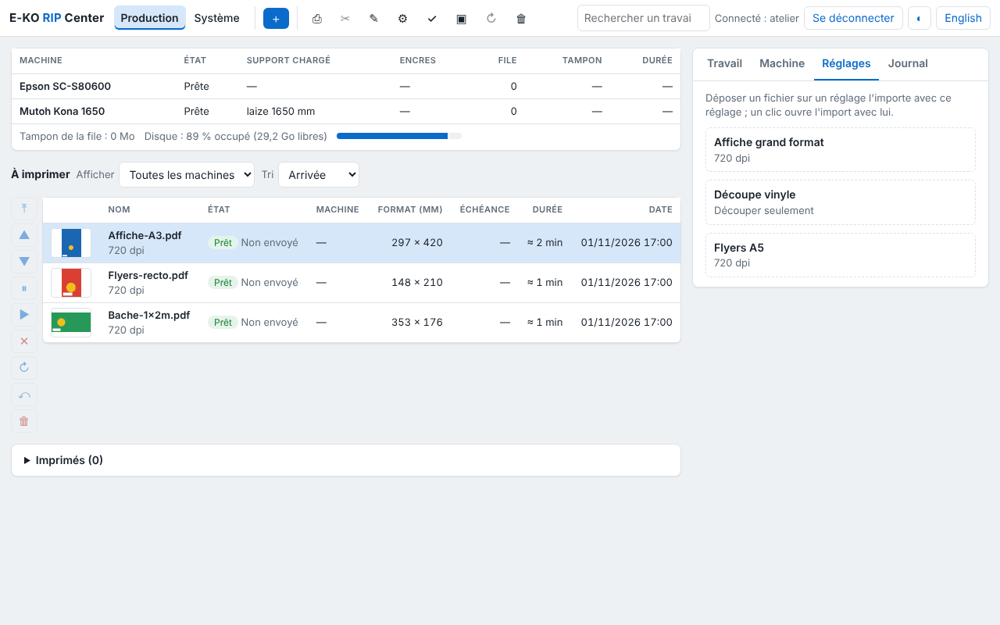

Cette page s'adresse à la personne qui fait vivre le serveur : comptes, sauvegardes, mises à
jour, dossiers partagés et réglages avancés. Les commandes se tapent sur le serveur, dans un
terminal ou par SSH.

## Au quotidien

```bash
systemctl status eko-rip-serveur        # le service tourne-t-il ?
journalctl -u eko-rip-serveur -f        # journal en direct
sudo systemctl restart eko-rip-serveur  # redémarrer
```

Le journal note chaque rendu raté et chaque sortie échouée, avec la machine, le travail et la
raison. Dans le client, la vue **Système** montre la version, la place libre sur le disque et
la durée de conservation des travaux.

Un redémarrage coupe le rendu en cours : le travail passe en échec « interrompu », à relancer
avec **Relancer**. Les sorties en file restent dans la file ; chacun se reconnecte.

## Comptes

| Action | Commande |
|---|---|
| Ajouter un administrateur | `sudo -u eko-rip env EKO_RIP_DATA=/var/lib/eko-rip eko-rip-serveur utilisateur ajouter <nom> admin` |
| Ajouter un opérateur | `… utilisateur ajouter <nom> operateur` |
| Lister les comptes | `… utilisateur liste` |
| Supprimer un compte | `… utilisateur supprimer <nom>` |

- **Mot de passe oublié** ou **changement de rôle** : redéclarer le compte avec
  `utilisateur ajouter` ; le nouveau mot de passe et le rôle remplacent les anciens.
- **5 mots de passe faux** bloquent le nom 5 minutes.
- Supprimer un compte ferme aussitôt ses sessions. Aucun redémarrage n'est nécessaire.

## Sauvegarder

**La configuration** (machines, supports, tarifs, réglages enregistrés, découpe, tons directs,
profils ICC) : dans le client, **Administration… › Système › Sauvegarde de la configuration ›
Télécharger la sauvegarde**. Garder le fichier hors du serveur, et refaire la sauvegarde après
chaque changement de réglages.

**Tout, comptes compris** : copier le dossier `/var/lib/eko-rip`, service arrêté. Les travaux
sont volumineux et se refont depuis leurs fichiers sources : la configuration et le fichier des
comptes (`utilisateurs.json`) suffisent souvent.

**Avant chaque mise à jour**, le paquet copie seul la configuration dans
`/var/lib/eko-rip/sauvegardes/` (les 10 dernières sont gardées).

### Remonter un serveur

1. Installer le serveur sur le nouveau PC ([Installer le serveur](serveur.md)).
2. Créer le compte administrateur.
3. Dans le client : **Système › Sauvegarde de la configuration › Restaurer…** et choisir le
   fichier. Tout est vérifié avant d'écrire : un fichier abîmé ne change rien.
4. Recréer les comptes opérateurs.

## Mettre à jour

Par le dépôt APT (serveur installé comme conseillé) :

```bash
sudo apt update && sudo apt upgrade
```

Les données restent en place. L'interface d'administration vient du serveur : les nouveautés y
apparaissent dès sa mise à jour. Les clients se mettent à jour à part (voir
[Installer les clients](clients.md)).

Les nouveautés de chaque version sont dans le [journal des versions](https://e-ko.rip/changelog/),
avec un abonnement par e-mail.

## Partager les dossiers surveillés

Chaque réglage enregistré a un dossier `/var/lib/eko-rip/entrees/<réglage>/` : un fichier déposé
dedans part au RIP avec ce réglage. Pour y déposer depuis les postes :




```bash
sudo apt install samba
```

Ajouter à la fin de `/etc/samba/smb.conf` :

```ini
[eko-rip]
   path = /var/lib/eko-rip/entrees
   writable = yes
   force user = eko-rip
   valid users = eko
```

Puis `sudo smbpasswd -a eko` et `sudo systemctl restart smbd`. Les postes ouvrent
`smb://<serveur>/eko-rip` (Mac, Linux) ou `\\<serveur>\eko-rip` (Windows).

> [!NOTE]
> Les dossiers surveillés ne demandent pas de compte du RIP : leur accès se règle par le
> partage Samba.

## Réglages avancés

Dans `/etc/default/eko-rip-serveur`, puis `sudo systemctl restart eko-rip-serveur`.

| Réglage | Par défaut | Rôle |
|---|---|---|
| `EKO_RIP_ADDR` | `0.0.0.0:8640` | adresse et port d'écoute |
| `EKO_RIP_DATA` | `/var/lib/eko-rip` | dossier des données |
| `EKO_RIP_MAX_MO` | `8192` | taille maximale d'un fichier reçu, en Mo |
| `EKO_RIP_DELAI_S` | `1800` | durée maximale d'un rendu, en secondes |
| `EKO_RIP_RENDUS` | un par cœur, 4 au plus | rendus menés en même temps (1 à 16) |
| `EKO_RIP_CONSERVATION_JOURS` | `30` | travaux effacés après ce nombre de jours (0 : jamais) |
| `EKO_RIP_SEUIL_LIBRE_MO` | `5120` | espace libre gardé ; en dessous, purge des vieux travaux |
| `EKO_RIP_SEUIL_ALERTE_MO` | `20480` | seuil de l'alerte « disque presque plein » |
| `EKO_RIP_PLOTTER` | `/dev/kona` | port de la découpeuse en USB |
| `EKO_RIP_EPSON_SNMP` | (vide) | adresse de l'Epson pour lire le média chargé |
| `EKO_RIP_ANNONCE` | `1` | `0` : ne pas s'annoncer sur le réseau (adresse à saisir dans les clients) |
| `EKO_RIP_CLOUD_NOM` | nom du PC | nom proposé pour le site sur le Cloud |

La référence complète (tous les réglages, l'emplacement de chaque fichier de données) est dans
la [documentation technique](https://github.com/mvignaud/eko-rip-center/blob/main/docs/fr/installation-serveur.md#réglages).

## Où sont les données

Tout est dans `/var/lib/eko-rip` : un dossier par travail (`travaux/`), la file
(`file.json`), le catalogue des machines (`machines.json`), les supports, les réglages, les
comptes (mots de passe hachés), les profils ICC et les dossiers surveillés (`entrees/`).
Chaque fichier de réglage garde sa version précédente (`.prec`) : après une coupure de
courant, le serveur la reprend seul et le signale dans **Système**.

## Statistiques et rapports de bug

**Statistiques anonymes** : le serveur et les clients envoient un signal d'installation
(version, système), sans aucune donnée de l'atelier ni des fichiers. Pour l'arrêter : décocher
**Système › Statistiques anonymes** (serveur), **Système › Confidentialité** (Mac) ou
**Système › Ce poste** (Linux) ; ou `EKO_TELEMETRIE=0` dans `/etc/default/eko-rip-serveur`.

**Signaler un problème** : menu **Aide** (Mac), menu principal (Linux) ou **Système › Rapports
de bug** dans l'administration. Le titre et la description sont publiés sur GitHub : n'y mettre
rien de confidentiel. Le journal du serveur joint et l'e-mail restent privés. Les rapports
d'erreur automatiques ne partent qu'après accord, demandé à la première ouverture de
l'administration.
