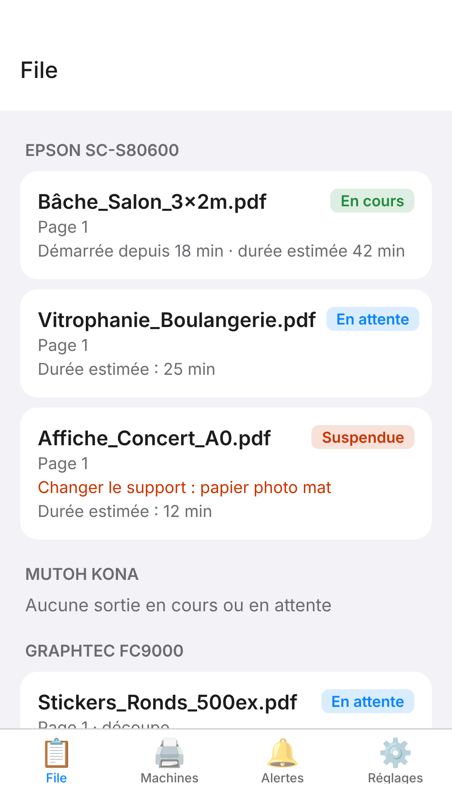
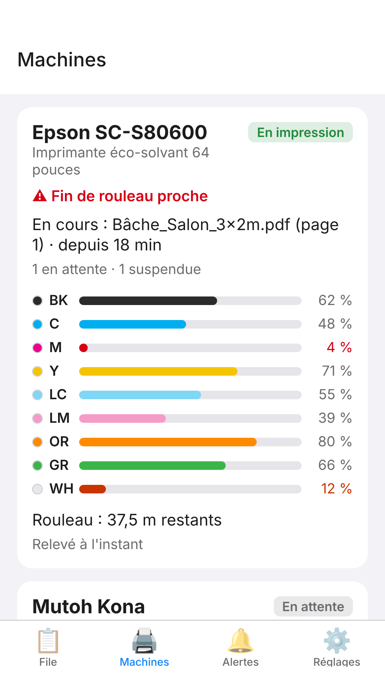
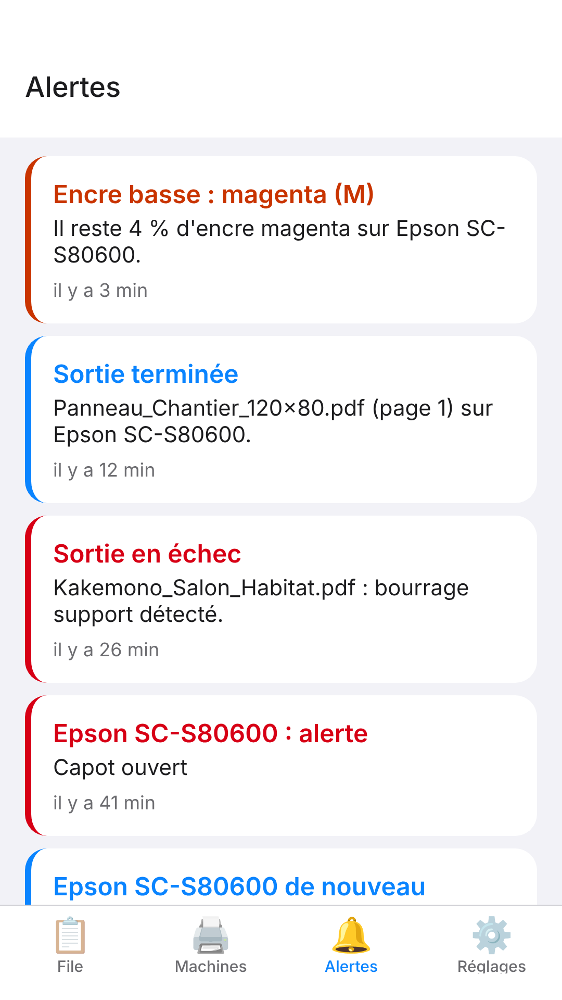

L'application **E-KO RIP** permet de suivre l'atelier depuis un téléphone : file d'impression, état des machines, niveaux d'encre et alertes. Elle prévient dès qu'une machine s'arrête en erreur, même quand le téléphone est en poche. Elle fonctionne sur iPhone et sur Android.

> [!NOTE]
> L'application sert au **suivi**. Elle n'envoie aucun fichier et ne règle ni l'impression ni la découpe : ces opérations restent à faire depuis un poste (voir [Clients](clients.md#client-mac)).

## Ce que l'application permet

- Voir la file d'impression de chaque machine, avec les sorties en cours en premier.
- Lancer, mettre en pause, arrêter, relancer ou passer en tête une sortie.
- Consulter l'état de chaque machine : impression, découpe, attente, injoignable.
- Contrôler le niveau de chaque encre et la longueur de support restant sur le rouleau.
- Lire l'historique des dernières alertes.
- Recevoir des notifications en cas d'erreur, d'encre presque vide ou de sortie en échec.

## Installer l'application

L'application sera bientôt disponible sur l'App Store et sur Google Play. Le lien de téléchargement et les nouveautés sont annoncés sur la page de l'application : <https://e-ko.rip/app/>.

> [!NOTE]
> Il n'est pas nécessaire d'avoir un compte E-KO pour installer l'application. Elle se connecte uniquement au serveur RIP de l'atelier.

## Se connecter à un serveur

L'application demande à quel serveur RIP se connecter. Deux cas sont possibles : à l'atelier avec l'adresse locale, ou à distance avec le cloud E-KO RIP.

### À l'atelier : adresse locale

Le téléphone doit être sur le réseau Wi-Fi de l'atelier.

1. Ouvrir l'application.
2. Dans le champ **Serveur**, saisir l'adresse du serveur RIP, par exemple `http://192.168.1.20:8640`. Cette adresse est celle utilisée dans les clients de bureau (voir [Installer le serveur](serveur.md)).
3. Toucher **Continuer**.
4. Si le serveur demande un compte, saisir le nom d'utilisateur et le mot de passe, puis toucher **Se connecter**.

Un compte **Opérateur** suffit pour suivre la file et agir sur les sorties. Les comptes se gèrent dans l'administration du serveur (voir [Administrer le serveur](administration.md#comptes)).

Le nom et le mot de passe sont gardés dans l'espace sécurisé du téléphone. L'application les réutilise pour rouvrir la session quand elle expire, après 12 heures ou après un redémarrage du serveur.

### Hors de l'atelier : cloud E-KO RIP

Le cloud permet de joindre le serveur de l'atelier depuis l'extérieur, sans VPN. Il faut que le serveur soit déjà rattaché à la plate-forme (voir [Cloud E-KO RIP](cloud.md)).

Deux façons de faire :

- Saisir dans **Serveur** l'adresse à distance du site, de la forme `https://<site>.platform.e-ko.rip`, puis un compte du serveur RIP.
- Toucher **Se connecter au cloud** sous la mention « hors de l'atelier ». Saisir `platform.e-ko.rip` dans **Serveur** revient au même.

Avec **Se connecter au cloud** :

1. Toucher **Se connecter au cloud**. Le navigateur du téléphone s'ouvre sur la plate-forme.
2. Se connecter avec le compte de la plate-forme, puis autoriser l'application.
3. L'application s'ouvre sur l'écran **Vos sites**, qui liste les sites du compte, en ligne ou non.
4. Toucher le site voulu. Aucun second mot de passe n'est demandé.

Le rôle affiché dans l'application vient de celui donné au compte sur le site. L'accès reste valable environ 180 jours.

Pour se déconnecter du cloud, toucher **Se déconnecter du cloud** sur l'écran **Vos sites**. Il est aussi possible de déconnecter les apps depuis **Mon compte** sur le portail (voir [Cloud E-KO RIP](cloud.md)).

## Les onglets de l'application

L'application compte quatre onglets : **File**, **Machines**, **Alertes** et **Réglages**.

### File

L'onglet **File** liste les sorties de chaque machine. Les sorties en cours et en attente passent en premier, puis viennent les sorties terminées récemment.

Chaque sortie porte un état : **En cours**, **En attente**, **Suspendue**, **Terminée**, **Échec** ou **Annulée**. En cas d'échec, le message d'erreur s'affiche sous la sortie. La durée écoulée et la durée estimée sont indiquées quand elles sont connues.

Pour agir sur une sortie :

1. Toucher la sortie.
2. Choisir l'action voulue dans la liste.
3. Confirmer si l'application le demande.

Les actions proposées dépendent de l'état de la sortie :

| État de la sortie | Actions possibles |
|---|---|
| En attente | **Pause**, **Passer en tête**, **Stop** |
| Suspendue | **Lancer** ou **Reprendre**, **Passer en tête**, **Stop** |
| Terminée ou en échec | **Relancer** (crée une nouvelle sortie identique) |
| Imbriquée dans une planche | Aucune action |

> [!WARNING]
> **Pause** et **Stop** n'agissent que sur une sortie qui n'est pas encore partie vers la machine. Une impression déjà envoyée à la machine ne s'arrête pas depuis l'application. Pour l'interrompre, utiliser la machine elle-même.

### Machines

L'onglet **Machines** montre une carte par machine :

- l'état : **En impression**, **En découpe**, **En attente** ou **Injoignable** ;
- la sortie en cours ;
- le niveau de chaque encre, avec les niveaux bas mis en évidence ;
- la longueur de support restante sur le rouleau ;
- les alertes en cours (capot ouvert, fin de rouleau…) ;
- l'heure du dernier relevé.

Le serveur interroge les machines Epson environ une fois par minute. Les valeurs affichées ont donc au plus quelques instants de retard.

### Alertes

L'onglet **Alertes** garde les 200 derniers événements : alertes de machine, encre presque vide, sorties en échec, machine injoignable. Une pastille signale les événements non encore vus.

### Réglages

L'onglet **Réglages** affiche :

- le serveur, l'utilisateur et le rôle (**Administrateur** ou **Opérateur**) ;
- les interrupteurs de notifications ;
- le bouton **Envoyer une notification d'essai** ;
- le bouton **Se déconnecter** et le numéro de version de l'application ;
- le lien **Aide / Documentation**, qui ouvre cette page.

## Notifications

Les notifications préviennent même quand l'application est fermée.

### Activer les notifications

1. Accepter l'autorisation demandée par le téléphone à la première connexion.
2. Ouvrir l'onglet **Réglages** et vérifier que **Notifications** est activé.
3. Toucher **Envoyer une notification d'essai** : elle doit arriver en quelques secondes.

Dans **Réglages**, deux interrupteurs précisent ce qui est reçu :

- **Erreurs machine** : alertes, encre, échecs, machine injoignable.
- **Fins d'impression** : une notification à chaque impression terminée. Cette option est désactivée par défaut.

### Événements notifiés

| Événement | Quand |
|---|---|
| Alerte de la machine | Une nouvelle alerte apparaît (capot ouvert, support épuisé…). Les états ordinaires (prête, impression, chauffe, veille) ne notifient pas. |
| Encre presque vide | Une encre passe à 5 % ou moins. |
| Cartouche vide | Une encre atteint 0 %. |
| Machine injoignable | Trois relevés de suite sans réponse, puis une notification quand elle répond de nouveau. |
| Sortie en échec | Une impression ou une découpe échoue. |
| Rendu en échec | Le rendu d'un travail échoue. |
| Fin d'impression | Seulement si **Fins d'impression** est activé. |

Après un redémarrage du serveur, aucune rafale de notifications n'est envoyée : le serveur reprend simplement l'état du moment.

### Notifications du cloud

Quand l'application est connectée au cloud, elle demande l'autorisation des notifications juste après la première connexion. Elle reçoit alors aussi les notifications de la plate-forme : site hors ligne, site de retour en ligne, nouvelle app connectée au compte. Ces notifications suivent la case **Recevoir les alertes** de **Mon compte** sur le portail (voir [Cloud E-KO RIP](cloud.md)).

Un téléphone reste inscrit tant que l'application est ouverte au moins une fois tous les 30 jours.

> [!TIP]
> En l'absence de notification, vérifier l'autorisation dans les réglages du téléphone, puis l'interrupteur **Notifications** dans l'application. Se déconnecter puis se reconnecter renouvelle l'inscription du téléphone auprès du serveur.

> [!NOTE]
> Les notifications des machines sont envoyées par le serveur RIP. Il doit donc avoir un accès à Internet.

## Mode démo

Le mode démo montre l'application avec des données fictives, sans serveur et sans connexion.

1. Sur l'écran de connexion, toucher **Essayer le mode démo**.
2. Parcourir les onglets : rien n'est enregistré et rien n'est envoyé.
3. Pour sortir, ouvrir **Réglages** et toucher **Quitter le mode démo**.

## Confidentialité

L'application parle uniquement au serveur RIP de l'atelier et, si elle est utilisée, à la plate-forme E-KO RIP Cloud. L'application ne contient ni publicité ni mesure d'audience. Sans connexion par le Cloud, l'éditeur ne reçoit rien ; avec elle, la plate-forme connaît votre compte, le nom du téléphone et, si les notifications sont actives, son jeton de notification.

- Les identifiants sont gardés dans l'espace sécurisé du téléphone et envoyés uniquement au serveur choisi.
- Pour les notifications, un jeton du téléphone est transmis au serveur (ou à la plate-forme E-KO RIP Cloud si vous vous y connectez) ; les messages transitent ensuite par le service de notifications d'Expo, puis par Apple ou Google.
- Se déconnecter supprime les identifiants du téléphone et retire le téléphone de la liste des notifications.

La politique complète est publiée à l'adresse <https://e-ko.rip/app/confidentialite/>.

## Questions fréquentes

### Quelle adresse saisir pour me connecter ?

À l'atelier, l'adresse locale du serveur (par exemple `http://192.168.1.20:8640`). Hors de l'atelier, l'adresse du site sur le cloud (`https://<site>.platform.e-ko.rip`) ou le bouton **Se connecter au cloud**. Voir [Cloud E-KO RIP](cloud.md).

### L'application n'arrive pas à joindre le serveur

1. Vérifier que le téléphone est sur le Wi-Fi de l'atelier, s'il s'agit de l'adresse locale.
2. Vérifier l'adresse saisie, sans espace.
3. Hors de l'atelier, utiliser le cloud : l'adresse locale n'est joignable que sur place.

Si le problème persiste, voir [Dépannage](depannage.md).

### Le site est « hors ligne » dans la liste

Le serveur RIP de l'atelier n'est pas relié à la plate-forme : il est éteint ou sans Internet. Vérifier le serveur sur place (voir [Cloud E-KO RIP](cloud.md)).

### Je ne reçois pas les notifications

Vérifier l'autorisation dans les réglages du téléphone, l'interrupteur **Notifications** dans **Réglages**, puis que le serveur RIP est à jour. Se déconnecter et se reconnecter renouvelle l'inscription.

### Puis-je envoyer un fichier à imprimer depuis le téléphone ?

Non. L'envoi des fichiers se fait depuis un poste ou le navigateur (voir [Installer les clients](clients.md#client-mac)).

### Pourquoi l'impression continue-t-elle après **Stop** ?

**Stop** annule une sortie en attente ou suspendue. Une impression déjà partie vers la machine ne s'interrompt pas depuis l'application.

### Une question, un problème ?

Écrire à contact@e-ko.rip.
