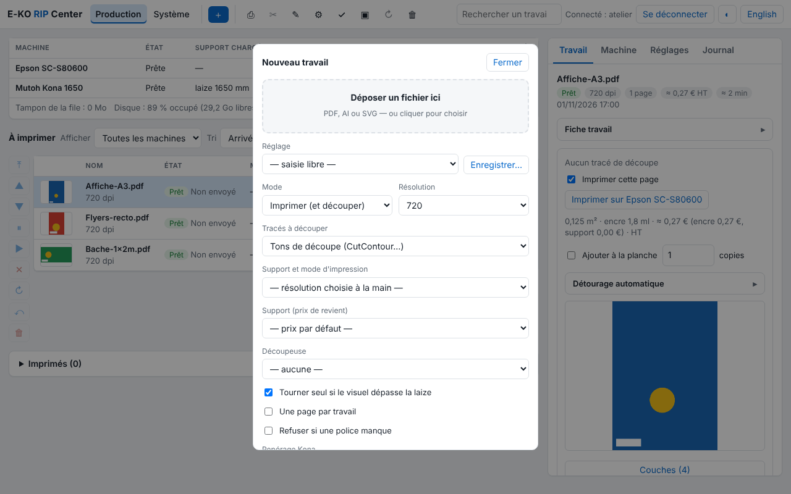
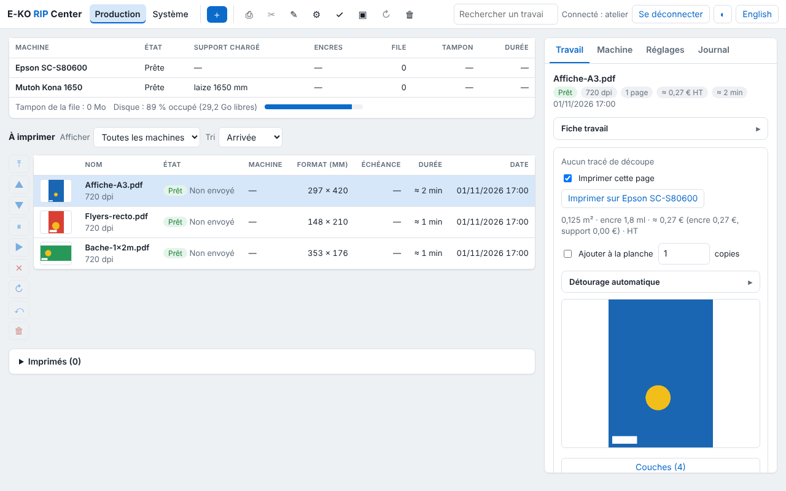
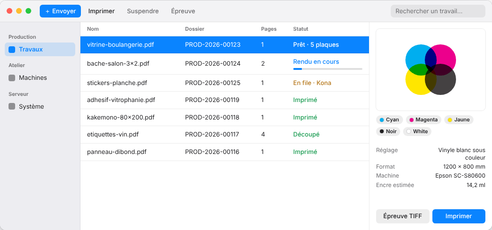

Le client E-KO RIP Center est le logiciel des postes de travail : on y envoie les fichiers, on
suit les travaux et la file, on lance les impressions et les découpes. Il existe pour Mac, Linux
et Windows ; tous parlent au même serveur et voient la même file.

## Ce que fait le client

La fenêtre a trois volets :

- à gauche, la **barre latérale** : **Travaux**, **Machines**, **Système** ;
- au centre, le **tableau des travaux** (nom, dossier, pages, état, date), avec une recherche ;
- à droite, l'**inspecteur** du travail choisi : aperçu, fiche, plaques d'encre, alertes et
  actions **Imprimer**, **Relancer**, **Épreuve TIFF**, **Supprimer**.

On envoie un fichier en le **glissant sur la fenêtre** (ou sur l'icône du Dock sur Mac), ou
avec le bouton **+** : le client demande le réglage à appliquer et, en option, le client, la
commande et la quantité. Formats acceptés : PDF, AI compatible PDF, SVG, TIFF, PNG et JPEG.
Une notification prévient quand le rendu est prêt.



Les écrans de réglage complets (machines, supports, couleur, découpe, comptes, sauvegarde,
Cloud) s'ouvrent par le menu **Administration…**. Leur mode d'emploi est dans le
[guide d'utilisation](../../fr/utilisation.md).



## Client Mac



**Pré-requis** : macOS 14 (Sonoma) ou plus récent, Mac Apple Silicon ou Intel.

1. Télécharger le client : [e-ko.rip/telecharger/mac](https://e-ko.rip/telecharger/mac)
   (fichier `.dmg` de la dernière version).
2. Ouvrir le `.dmg` et glisser **E-KO RIP Center** dans **Applications**.
3. Lancer l'application. Elle est signée et vérifiée par Apple : elle s'ouvre sans
   avertissement.
4. Au premier lancement, macOS demande l'accès au **réseau local** : accepter, sinon le
   serveur n'est pas trouvé.

**Mises à jour** : télécharger et remplacer l'application par la nouvelle version. Le serveur
et le client se mettent à jour séparément ; un client un peu plus ancien que le serveur continue
de fonctionner.

**Menus utiles** : **Serveur › Changer de serveur…**, **Serveur › Administration…**,
**Serveur › Se déconnecter**, **Aide › Signaler un problème…**.

## Client Linux

 : même organisation que sur Mac")

**Pré-requis** : Ubuntu 24.04 ou plus récent, ou Debian 13 (bureau GNOME conseillé), PC 64 bits.

Installer en une commande ; le dépôt E-KO est ajouté au système :

```bash
wget -qO- https://apt.e-ko.fr/rip/installer | sudo sh
```

Le client apparaît dans les applications sous le nom **E-KO RIP Center**. Il se met ensuite à
jour avec le reste du système :

```bash
sudo apt update && sudo apt upgrade
```

**Menu principal** (bouton ☰ en haut à droite) : **Administration…**, **Signaler un
problème…**, **Changer de serveur…**, **Se déconnecter**, **À propos d'E-KO RIP Center**.

## Client Windows

")

**Pré-requis** : Windows 10 ou 11, 64 bits.

1. Télécharger l'installateur : [e-ko.rip/telecharger/windows](https://e-ko.rip/telecharger/windows).
2. Lancer le fichier `…_x64-setup.exe` et suivre l'assistant.
3. Le client n'est pas encore signé : si Windows affiche « Windows a protégé votre ordinateur »,
   cliquer **Informations complémentaires** puis **Exécuter quand même** (une seule fois par
   poste).

> [!NOTE]
> Un client Windows natif, sur le modèle des clients Mac et Linux, est en préparation. En
> attendant, le client Windows ouvre l'interface du serveur dans sa fenêtre : toutes les
> fonctions y sont, avec une présentation différente.

## Se connecter au serveur

Au premier lancement, l'écran de connexion cherche seul les serveurs E-KO RIP du réseau local
et les liste dans **Serveurs trouvés sur le réseau** (nom, adresse, version) : un clic suffit.

- **Rechercher à nouveau** relance la recherche (environ 3 secondes).
- Si rien n'apparaît, saisir l'adresse sous **Saisir une adresse**, par exemple
  `192.168.1.20:8640`. La découverte ne traverse ni les routeurs ni les VPN.
- Si le serveur a des comptes, le client demande ensuite le nom et le mot de passe. La session
  dure 12 heures.

Le client retient le serveur. Pour en changer : **Changer de serveur…**
(<kbd>Cmd</kbd> + <kbd>Maj</kbd> + <kbd>S</kbd> sur Mac).

### Depuis l'extérieur de l'atelier

Si le serveur est rattaché au [Cloud E-KO RIP](cloud.md), saisir comme adresse celle du site,
par exemple `https://atelier.platform.e-ko.rip`, puis se connecter avec son compte du serveur.
Avec le bouton **Se connecter au cloud** (clients Mac et Linux), le client ouvre le navigateur
pour se connecter à son compte Cloud, puis liste ses sites : un clic suffit.

## Plusieurs serveurs

Un client ne parle qu'à un serveur à la fois. Pour passer d'un atelier à l'autre (ou du réseau
local au Cloud), utiliser **Changer de serveur…** : la liste propose les serveurs trouvés et
l'adresse saisie la dernière fois.
