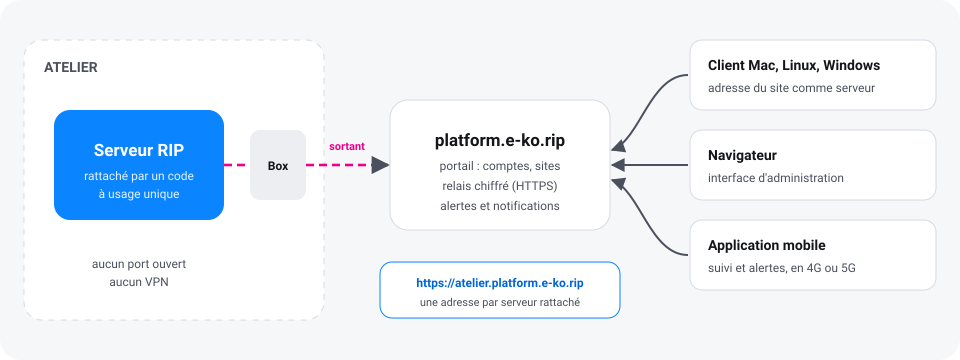
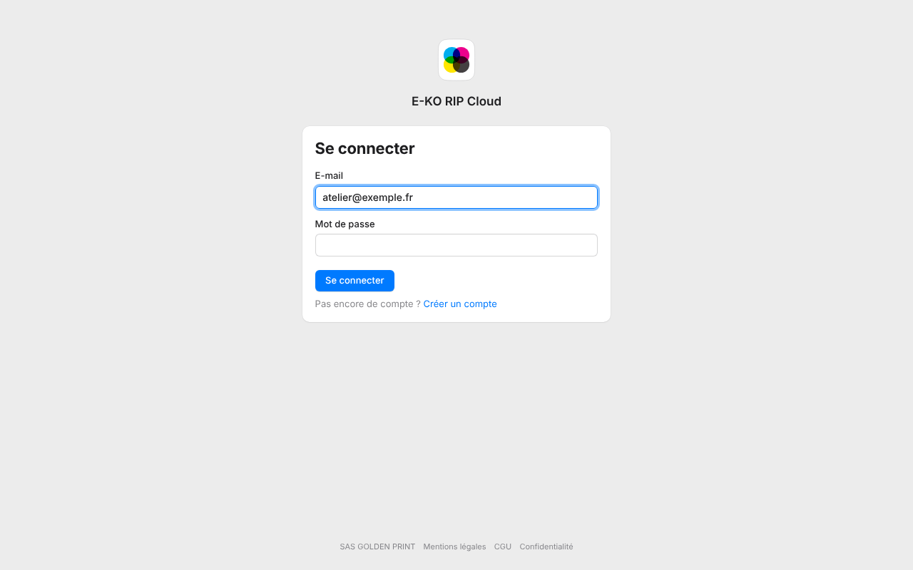
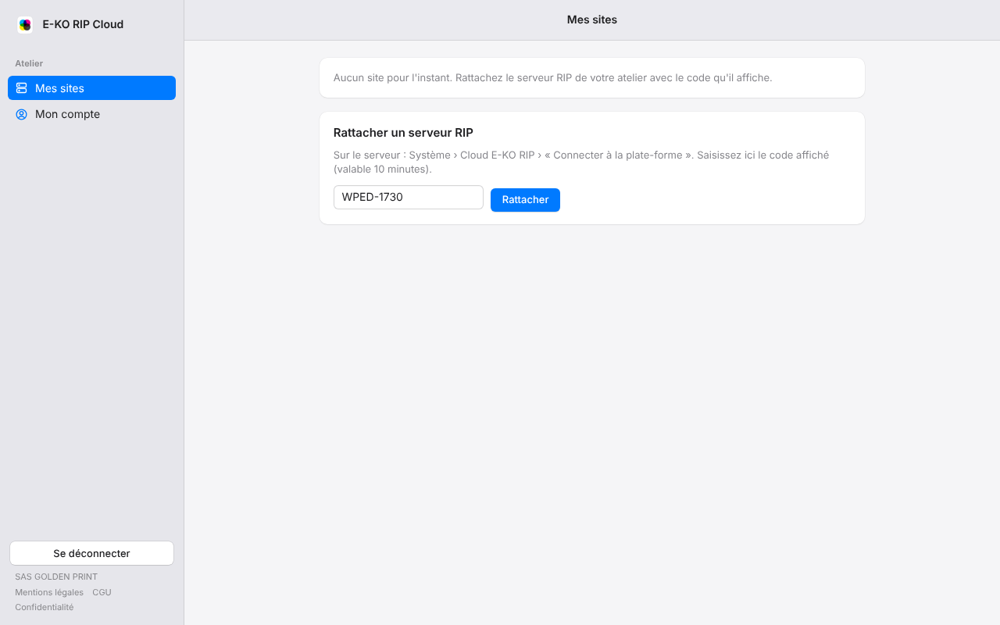
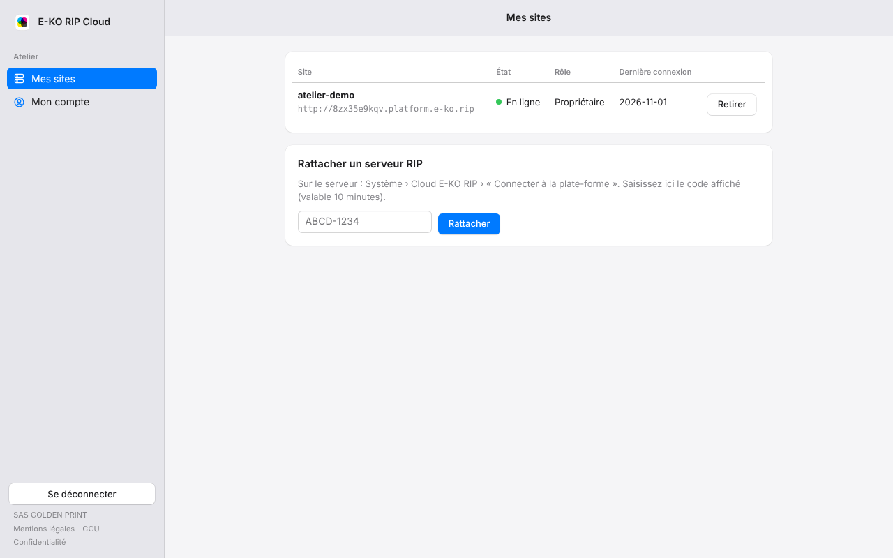
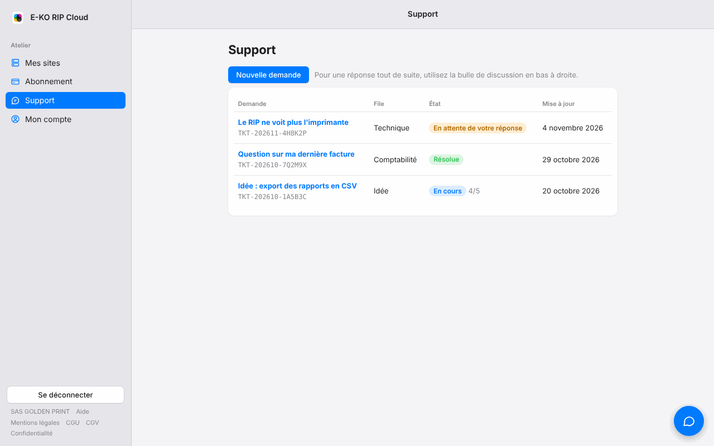
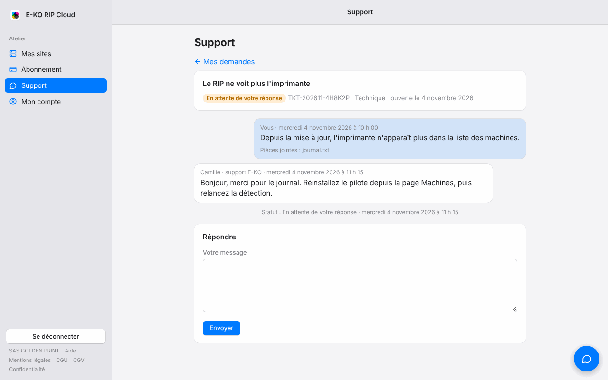
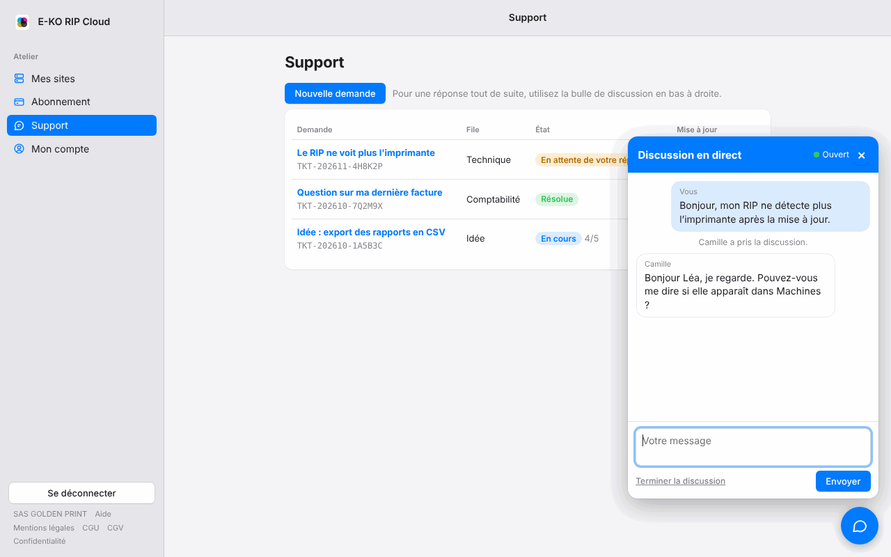

Le cloud **E-KO RIP** donne accès au serveur RIP de l'atelier depuis l'extérieur : à la maison, chez un client, en déplacement. Il fonctionne sans VPN et sans rien changer à la box Internet. Le service est gratuit pour un petit atelier ; des [offres payantes](#offres-et-abonnement) couvrent les ateliers plus grands.



## À quoi sert le cloud

Sans le cloud, le serveur RIP n'est joignable que sur le réseau de l'atelier. Avec le cloud :

- les postes (Mac, Linux, Windows) se connectent au serveur depuis n'importe où ;
- l'interface d'administration s'ouvre dans un navigateur, comme à l'atelier ;
- l'[application mobile](application-mobile.md) suit la production hors de l'atelier ;
- des notifications et des e-mails préviennent quand le serveur ne répond plus.

Le principe est simple : c'est le serveur de l'atelier qui ouvre lui-même une connexion vers la plate-forme. **Aucun port n'est à ouvrir** sur la box. Les postes et les téléphones à distance passent par la plate-forme pour atteindre le serveur.

> [!NOTE]
> Le cloud est facultatif. Le serveur continue de fonctionner normalement à l'atelier, avec ou sans lui.

## Créer un compte

Le portail de la plate-forme se trouve à l'adresse <https://platform.e-ko.rip>.



1. Ouvrir <https://platform.e-ko.rip>.
2. Choisir **Créer un compte**.
3. Saisir le nom (ou le nom de l'atelier), l'adresse e-mail et un mot de passe d'au moins 10 caractères.
4. Accepter les conditions d'utilisation, puis valider.

Si la page propose **Google** ou **Facebook**, ces boutons permettent aussi de s'inscrire sans mot de passe.

### Confirmer l'adresse e-mail

Un e-mail de confirmation est envoyé à l'inscription par mot de passe.

1. Ouvrir l'e-mail envoyé par **E-KO RIP Cloud** (`no-reply@e-ko.fr`).
2. Cliquer sur le lien de confirmation, valable 24 heures.
3. Cliquer sur le bouton de la page pour valider.

Tant que l'adresse n'est pas confirmée, un bandeau l'indique sur **Mes sites** et **Mon compte**. Il propose **Renvoyer l'e-mail**. Rattacher un serveur est refusé jusqu'à la confirmation. Le reste du portail fonctionne.

Un compte créé avec Google est confirmé d'office.

> [!TIP]
> Si l'e-mail n'arrive pas, regarder dans les courriers indésirables, puis demander un nouvel envoi depuis le bandeau.

## Rattacher un serveur RIP

Le rattachement se fait en deux temps : un code sur le serveur, puis la saisie de ce code sur le portail. Compter deux minutes.

### Avant de commencer

Le serveur doit avoir **au moins un compte utilisateur**. Sans compte, l'accès au serveur est libre sur le réseau local, et le cloud refuse de s'ouvrir pour ne pas laisser l'atelier ouvert à tous.

Pour créer un compte, voir [Administrer le serveur](administration.md#comptes). Le serveur doit aussi avoir accès à Internet (voir [Installer le serveur](serveur.md)).

### Pas à pas

1. Ouvrir l'interface d'administration du serveur RIP, avec un compte administrateur.
2. Aller dans **Système › Cloud E-KO RIP**.
3. Cliquer sur **Connecter à la plate-forme**. Le serveur affiche un code court, de la forme `KXRT-4821`, valable **10 minutes**.
4. Sur le portail, se connecter avec son compte.
5. Aller dans **Mes sites**, rubrique **Rattacher un serveur RIP**.
6. Saisir le code, puis cliquer sur **Rattacher**.



> [!TIP]
> Le serveur affiche aussi un lien : l'ouvrir mène directement à la page de saisie du code.

Quelques secondes plus tard, le serveur est relié. L'écran **Système › Cloud E-KO RIP** indique **Connecté : accessible à distance** et affiche l'**Adresse à distance**. Le compte qui a saisi le code devient propriétaire du site.



Le portail permet de rattacher jusqu'à 10 sites par compte.

> [!NOTE]
> Après une coupure de réseau, le serveur se reconnecte tout seul, sans intervention.

## Utiliser l'accès à distance

Chaque site a sa propre adresse :

```
https://<site>.platform.e-ko.rip
```

Elle est visible dans **Système › Cloud E-KO RIP** sur le serveur, et dans **Mes sites** sur le portail. Elle sert dans trois cas.

### Dans un client de bureau

1. Ouvrir le client (voir [Mac](clients.md#client-mac), [Linux](clients.md#client-linux) ou [Windows](clients.md#client-windows)).
2. Saisir l'adresse du site à la place de l'adresse locale du serveur.
3. Se connecter avec un compte du serveur RIP.

### Dans un navigateur

1. Ouvrir l'adresse du site.
2. Se connecter avec un compte du serveur RIP.

L'interface d'administration fonctionne comme à l'atelier.

### Dans l'application mobile

Saisir l'adresse du site dans le champ **Serveur**, ou utiliser **Se connecter au cloud** (voir ci-dessous). Détails dans [Application mobile](application-mobile.md).

> [!NOTE]
> Les comptes utilisés à distance sont ceux du serveur RIP, ceux de [Administrer le serveur](administration.md#comptes). Le compte de la plate-forme sert au portail et à **Se connecter au cloud**.

## Se connecter au cloud depuis les apps

Les apps Mac, Linux et mobile proposent un bouton **Se connecter au cloud** sur leur écran de connexion. Il évite de saisir une adresse et un second mot de passe.

1. Cliquer sur **Se connecter au cloud**. Le navigateur s'ouvre sur la plate-forme.
2. Se connecter avec son compte (mot de passe, Google ou Facebook).
3. Autoriser l'application quand le portail le demande.
4. Revenir à l'application : elle affiche la liste des sites du compte, en ligne ou non.
5. Choisir le site voulu.

Les droits dans l'application suivent le rôle du compte sur le site : un propriétaire ou un administrateur est administrateur du RIP, un opérateur est opérateur, un compte en lecture ne peut rien modifier.

L'accès d'une app reste valable environ 180 jours. À chaque nouvelle app connectée, un e-mail de sécurité est envoyé au titulaire du compte.

### Déconnecter une app

1. Se connecter au portail.
2. Ouvrir **Mon compte**.
3. Dans **Apps connectées**, cliquer sur **Déconnecter toutes les apps**.

Dans l'app elle-même, **Se déconnecter du cloud** retire l'accès de l'appareil.

> [!NOTE]
> Partager un site avec d'autres comptes (collègues, prestataires) avec un rôle opérateur ou lecture est prévu bientôt. Pour l'instant, le propriétaire du site est le compte qui l'a rattaché.

## E-mails de la plate-forme

La plate-forme écrit depuis **E-KO RIP Cloud**, adresse `no-reply@e-ko.fr`. Il n'y a rien à configurer. Ne pas répondre à ces messages.

| E-mail | Quand |
|---|---|
| Mot de passe oublié | À la demande, avec un lien valable 1 heure, utilisable une seule fois. |
| Confirmation de l'adresse | À l'inscription par mot de passe, lien valable 24 heures. |
| Site hors ligne | Le serveur est injoignable depuis 15 minutes. |
| Site de nouveau en ligne | Le serveur répond de nouveau, uniquement si l'alerte « hors ligne » est partie. |
| Nouvelle app connectée | Une app vient de se connecter au compte. |
| Résumé hebdomadaire | Chaque lundi vers 8 h, pour chaque site. |
| Demande reçue | Votre demande au support est enregistrée. |
| Réponse du support | L'équipe répond à votre demande, avec un extrait du message. |
| Demande résolue | La demande est résolue, avec le lien pour noter le support. |
| Discussion transformée en demande | Personne n'a pu prendre la discussion en direct : elle devient une demande, avec la transcription. |

Les alertes de site hors ligne concernent les propriétaires et les administrateurs du site. Au plus une alerte est envoyée par site et par heure.

Le résumé hebdomadaire indique, pour chaque site : le nombre de coupures, la durée totale hors ligne, la plus longue coupure, les alertes envoyées et les apps connectées dans la semaine.

### Choisir les e-mails reçus

1. Ouvrir **Mon compte** sur le portail.
2. Cocher ou décocher **Recevoir les alertes** et **Recevoir le résumé hebdomadaire**.

Les deux cases sont cochées par défaut. L'e-mail « nouvelle app connectée » est toujours envoyé : c'est une mesure de sécurité. Les e-mails du support (demande reçue, réponse, demande résolue) le sont aussi : ils répondent à une demande que vous avez faite.

### Mot de passe oublié

1. Sur la page de connexion, cliquer sur **Mot de passe oublié ?**.
2. Saisir l'adresse e-mail du compte.
3. Ouvrir l'e-mail reçu et cliquer sur le lien dans l'heure.
4. Choisir un nouveau mot de passe.

Pour des raisons de sécurité, la page répond de la même façon que l'adresse existe ou non. Le nouveau mot de passe ferme toutes les sessions du compte et déconnecte ses apps.

## Notifications

Les mêmes événements que les alertes par e-mail peuvent arriver en notifications : **site hors ligne**, **site de retour en ligne** et **nouvelle app connectée**. Elles suivent la case **Recevoir les alertes**. Les réponses du support et les demandes résolues sont aussi notifiées.

### Dans le navigateur

Après la première connexion au portail, la page **Mes sites** propose **Recevoir les alertes sur cet ordinateur ?**

1. Cliquer sur **Activer**.
2. Autoriser les notifications quand le navigateur le demande.

Le bouton **Plus tard** repousse le choix, et la question ne revient plus ensuite. Pour décider plus tard :

1. Ouvrir **Mon compte**.
2. Dans la carte **Notifications sur cet appareil**, cliquer sur **Activer les notifications du navigateur**.
3. Pour arrêter sur un navigateur, cliquer sur **Retirer** à côté de lui.

Les notifications arrivent même quand la page du portail est fermée, tant que le navigateur est lancé.

### Dans les apps Mac, Linux et mobile

Les apps demandent l'autorisation d'afficher des notifications juste après la première connexion au cloud. Il suffit d'accepter. Si l'autorisation a été refusée, la rétablir dans les réglages du système ou du téléphone.

## Support et discussion en direct

Une question, un problème, une idée ? Le support d'E-KO se joint depuis le portail, sans autre compte à créer : cliquer sur **Support** dans la barre latérale.



### Ouvrir une demande

1. Cliquer sur **Support**, puis sur **Nouvelle demande**.
2. Choisir la **File** : Technique, Comptabilité, Commercial ou Idée.
3. Saisir le **Sujet** et le message. Joindre au besoin une copie d'écran ou un journal : 5 fichiers de 10 Mo au plus.
4. Cliquer sur **Envoyer la demande**.

Un e-mail confirme la réception, avec la référence de la demande (`TKT-…`). Le fil de la demande, les réponses de l'équipe et un champ pour répondre se trouvent dans **Support**, en cliquant sur la demande.



### Suivre et répondre

Chaque réponse de l'équipe arrive par e-mail et par une notification, avec un lien qui ouvre directement la demande. Répondre depuis la page, pas depuis l'e-mail : l'adresse d'envoi (`no-reply`) ne lit pas les réponses.

L'état de la demande se lit dans la liste : **Reçue**, **En cours**, **En attente de votre réponse**, **Résolue** ou **Fermée**. Répondre à une demande résolue la rouvre. Une demande fermée ne reçoit plus de messages : ouvrir une nouvelle demande.

### Noter le support

Quand la demande est résolue, un e-mail propose de **Noter le support**. Sur la page de la demande, choisir une note de 1 (pas du tout satisfait) à 5 (très satisfait), ajouter un commentaire si on le souhaite, puis cliquer sur **Envoyer ma note**. La note peut être modifiée plus tard.

### Discussion en direct

Pour une réponse tout de suite, la bulle bleue en bas à droite de chaque page du portail ouvre une discussion avec l'équipe.



1. Cliquer sur la bulle. L'en-tête indique si le support est **Ouvert** ou **Fermé** ; fermé, la bulle rappelle les horaires d'ouverture.
2. Choisir le sujet, écrire le premier message, puis cliquer sur **Démarrer la discussion**.
3. Les messages de l'équipe s'affichent dans la bulle, quelques secondes après leur envoi. Fermer la bulle ne coupe pas la discussion, et une pastille rouge signale un nouveau message.
4. Cliquer sur **Terminer la discussion** pour y mettre fin.

> [!NOTE]
> Hors des heures d'ouverture du support, ou si personne ne prend la discussion en deux minutes, votre message devient automatiquement une demande. Un e-mail vous l'annonce, avec la transcription de ce que vous avez écrit, et la suite se passe dans **Support**.

## Gérer son compte

**Mon compte** regroupe :

- le nom, l'adresse e-mail et la date d'inscription ;
- les connexions liées (mot de passe, Google, Facebook) ;
- les cases d'e-mails et la carte **Notifications sur cet appareil** ;
- la liste des **Apps connectées** ;
- la suppression du compte.

### Supprimer son compte

1. Ouvrir **Mon compte**.
2. Aller à la rubrique **Supprimer mon compte**.
3. Confirmer.

> [!WARNING]
> La suppression efface le compte, ses droits et **les sites dont il est propriétaire**. Leur accès à distance s'arrête aussitôt. Le serveur RIP de l'atelier, lui, n'est pas touché : il reste utilisable sur place.

## Détacher un serveur

Détacher coupe l'accès à distance, sans toucher au serveur ni à ses données.

### Depuis le serveur

1. Ouvrir **Système › Cloud E-KO RIP**.
2. Cliquer sur **Détacher de la plate-forme**.
3. Confirmer.

L'accès à distance s'arrête aussitôt. Pour le rétablir, refaire le rattachement avec un nouveau code.

### Depuis le portail

1. Ouvrir **Mes sites**.
2. Cliquer sur **Retirer** à côté du site, puis confirmer.

Seul le propriétaire peut retirer un site.

## Offres et abonnement

Le cloud reste **gratuit pour un petit atelier** (1 site, 1 imprimante et 1 découpeur). Des offres payantes s'ajoutent pour les ateliers qui ont plus de machines ou plusieurs sites. Les prix sont **hors taxes**, et le nombre d'utilisateurs est **illimité** dans toutes les offres. Les offres payantes s'adressent aux professionnels.

| Offre | Prix (HT) | Sites | Machines | Sauvegardes en ligne | Stockage |
|---|---|---|---|---|---|
| Gratuit | 0 €, sans limite de durée | 1 | 1 imprimante + 1 découpeur | dernière version | 1 Go |
| À la machine | 6 € / mois par machine en plus des machines gratuites | 1 | à la demande | 30 versions | 5 Go par machine |
| Atelier | 19 € / mois | 1 | jusqu'à 5 (+4 € / mois par machine en plus) | 90 jours | 25 Go |
| Pro | 49 € / mois | 3 | jusqu'à 15 (+4 € / mois par machine en plus) | 1 an, restauration vers un autre site | 100 Go |
| Entreprise | sur devis | | | | |

- **Abonnement annuel** : 10 mois payés pour 12 mois de service.
- **Essai** : si votre première souscription payante est l'offre Atelier, vous avez 30 jours d'essai, sans facture avant la fin de l'essai (une carte est seulement vérifiée, sans débit). L'essai n'est offert qu'une fois par compte ; il est indiqué au moment de souscrire.
- **Machines comptées** : ce sont celles que votre serveur RIP déclare lui-même à la plate-forme. Il n'y a rien à saisir à la main ; la page **Abonnement** les liste site par site.
- **Entreprise** : pour un besoin plus large, écrire à contact@e-ko.rip.
- Les conditions complètes sont dans les [CGV](https://platform.e-ko.rip/cgv).

### Souscrire une offre

1. Ouvrir **Abonnement**, puis **Voir les offres**.
2. Choisir l'offre et la périodicité (mensuelle ou annuelle).
3. Renseigner l'entreprise. Saisir le SIREN ou le SIRET remplit automatiquement la raison sociale et l'adresse. Ajouter le contact, l'adresse e-mail de facturation, le téléphone (choisir le pays, drapeau et indicatif, puis saisir le numéro comme d'habitude, par exemple 06 12 34 56 78) et, si besoin, un numéro de bon de commande.
4. Si vous avez un code, le saisir dans le champ unique **Code promo ou partenaire**. Il est vérifié aussitôt et ses conditions s'affichent.
5. Cocher l'acceptation des CGV, puis choisir le moyen de paiement. Tout se fait dans la page, sans la quitter :
   - **Carte bancaire** : saisir la carte dans le champ sécurisé. Si la banque demande une confirmation (3-D Secure), elle s'affiche dans la page.
   - **Prélèvement SEPA** : saisir l'IBAN. Le mandat s'affiche dans la page ; un code est envoyé par SMS au téléphone mobile indiqué, et on signe le mandat par voie électronique en saisissant ce code.

Un e-mail confirme l'abonnement, puis chaque facture. Les factures sont émises par **GOLDEN PRINT** ; tous les e-mails viennent de **E-KO RIP**.

### Gérer son abonnement

La page **Abonnement** permet de :

- voir l'**utilisation** : machines et sites comptés, place de sauvegarde utilisée ;
- télécharger les **factures** au format PDF ;
- **changer d'offre** ou de périodicité : le changement est immédiat et une nouvelle période commence au prix de la nouvelle offre ;
- changer de **moyen de paiement** (nouvelle carte ou nouveau mandat) ;
- **résilier** : la résiliation prend effet à la fin de la période en cours, qui n'est pas remboursée, puis le compte revient à l'offre Gratuite.

Si un paiement échoue, un e-mail le signale et de nouvelles tentatives ont lieu, avec des relances. Sans régularisation, l'abonnement est résilié et le compte revient à l'offre Gratuite.

### Si le parc dépasse l'offre

Quand il y a plus de sites ou de machines que l'offre n'en comprend :

1. Un **e-mail** prévient le propriétaire et les administrateurs des sites.
2. Un **délai de 14 jours** permet de souscrire une offre adaptée ou de retirer les machines ou sites en trop.
3. Passé ce délai, l'**accès à distance** des sites concernés est **suspendu** jusqu'à régularisation.

> [!NOTE]
> L'utilisation à l'atelier n'est jamais touchée : le serveur RIP continue d'imprimer et de découper normalement. Seul l'accès à distance est suspendu.

## Sauvegardes en ligne

Le serveur RIP peut envoyer à la plate-forme une sauvegarde de sa **configuration** : c'est la même archive que **Système › Sauvegarde** (machines, réglages, profils ICC…). Elle ne contient **ni les travaux ni les comptes**. Les sauvegardes sont chiffrées et hébergées en France.

- **Quand** : chaque nuit (si la configuration a changé), environ 2 minutes après une modification, et à la demande d'un administrateur.
- **Combien de temps** : selon l'offre, la dernière version (Gratuit), 30 versions (À la machine), 90 jours (Atelier) ou 1 an (Pro). La plus récente est toujours gardée.
- **Alertes de place** : le propriétaire est prévenu quand le quota atteint 80 %, puis 100 %. À 100 %, les nouvelles sauvegardes sont refusées jusqu'à ce que de la place se libère ou que l'offre change.
- **Alerte d'échec** : si aucune sauvegarde de nuit n'arrive pendant deux nuits, un e-mail prévient le propriétaire et les administrateurs du site.

### Restaurer une sauvegarde

Le propriétaire et les administrateurs du site peuvent restaurer depuis le portail.

1. Ouvrir **Mes sites**, puis les **Sauvegardes** du site.
2. Repérer la version voulue (date, motif, taille). Elle peut aussi être téléchargée.
3. Cliquer sur **Restaurer** et confirmer. La configuration du serveur RIP est remplacée par celle de la sauvegarde.

Avec l'offre **Pro**, une sauvegarde peut aussi être restaurée vers un **autre site** du même propriétaire.

> [!WARNING]
> Une restauration remplace la configuration actuelle du serveur. En cas de doute, télécharger d'abord une sauvegarde de l'état actuel.

## Ce qui ne passe jamais par le cloud

Certaines fonctions restent réservées à l'atelier, même avec le cloud :

- le pont avec l'ERP et ses réglages ;
- le renvoi de travaux entre deux RIP ;
- le rattachement et le détachement du cloud lui-même : ils se font uniquement depuis l'atelier.

Le serveur refuse ces demandes quand elles arrivent par le cloud. Il les refuse aussi, par prudence, quand aucun compte n'est déclaré sur le serveur.

## Sécurité en bref

- Aucun port n'est ouvert à l'atelier : le serveur se connecte à la plate-forme, jamais l'inverse.
- Chaque site a sa propre adresse, isolée de celle des autres sites et du portail.
- Le mot de passe d'un compte est bloqué 5 minutes après 5 échecs.
- Le portail ne transmet à l'atelier que la session du serveur RIP, jamais les informations du compte de la plate-forme.

## Questions fréquentes

### Le site est « hors ligne »

Le serveur RIP de l'atelier n'est pas relié à la plate-forme.

1. Vérifier sur place que le serveur est allumé et qu'il a accès à Internet.
2. Ouvrir **Système › Cloud E-KO RIP**. Le message **Plate-forme injoignable** indique un problème de connexion Internet.
3. Attendre une minute : après une coupure, le serveur se reconnecte seul.

Si l'alerte est activée, un e-mail « de retour en ligne » confirme la reprise.

### Le code a expiré ou est refusé

Le code n'est valable que 10 minutes. Sur le serveur, cliquer de nouveau sur **Connecter à la plate-forme** pour en obtenir un nouveau. Si le portail refuse le rattachement, vérifier que l'adresse e-mail du compte est confirmée.

### Le cloud ne s'ouvre pas : « au moins un compte »

Créer un compte sur le serveur (voir [Administrer le serveur](administration.md#comptes)), puis recommencer.

### J'ai oublié mon mot de passe

Utiliser **Mot de passe oublié ?** sur la page de connexion (voir plus haut). S'il s'agit d'un compte du serveur RIP, voir [Administrer le serveur](administration.md#comptes).

### Mon accès à distance est suspendu

L'offre est dépassée depuis plus de 14 jours (trop de machines ou de sites). Ouvrir **Abonnement** : souscrire une offre adaptée ou retirer les machines en trop rétablit l'accès. L'utilisation à l'atelier n'a pas été interrompue.

### Je ne trouve pas mes sauvegardes en ligne

Elles se trouvent dans **Mes sites › Sauvegardes**. Si la dernière est ancienne, vérifier que le site est en ligne et que le quota de l'offre n'est pas plein.

### Je ne reçois pas les e-mails

Regarder dans les courriers indésirables. Vérifier l'adresse du compte dans **Mon compte** et les cases cochées. Les e-mails viennent de `no-reply@e-ko.fr`.

### Le support ne peut pas enregistrer ma demande

Le message « Votre compte n'est pas encore relié à un dossier client E-KO » signifie que le support ne retrouve pas votre société à partir de l'adresse e-mail du compte. Souscrire une offre relie le compte automatiquement. Sinon, écrire à E-KO depuis l'adresse de votre société, ou utiliser la même adresse e-mail que celle de vos échanges avec E-KO pour le compte du portail.

## Informations légales

- Conditions générales d'utilisation : <https://platform.e-ko.rip/cgu>
- Conditions générales de vente (offres payantes) : <https://platform.e-ko.rip/cgv>
- Politique de confidentialité : <https://platform.e-ko.rip/confidentialite>
- Mentions légales : <https://platform.e-ko.rip/mentions-legales>

Une question ? Écrire à contact@e-ko.rip.
