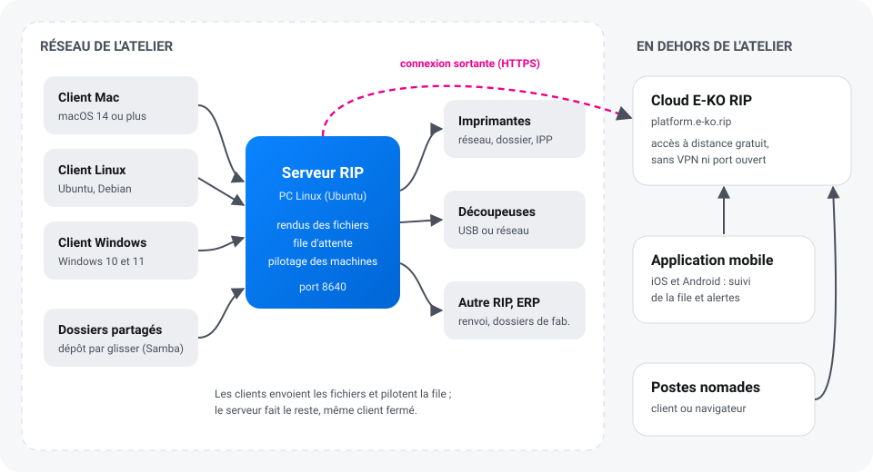
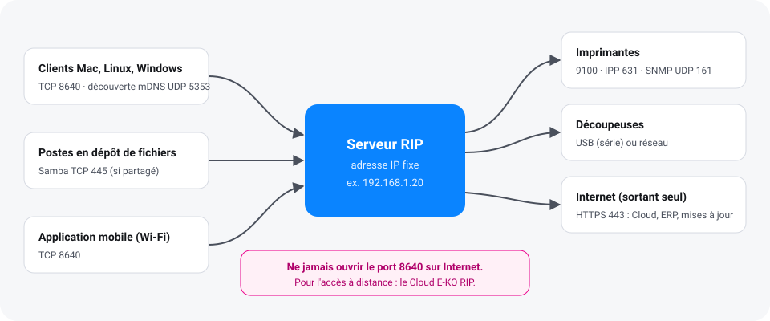

Cette page présente les pièces d'E-KO RIP Center et l'ordre dans lequel les installer. Compter
une heure pour un atelier simple : un serveur, un ou deux postes, une imprimante et une
découpeuse.

## Les pièces du RIP

| Pièce | Où | Rôle |
|---|---|---|
| **Serveur RIP** | un PC Linux de l'atelier, allumé en permanence | reçoit les fichiers, calcule les rendus, tient la file d'attente, pilote les machines |
| **Client E-KO RIP Center** | chaque poste de travail (Mac, Linux, Windows) | envoie les fichiers, suit les travaux, lance les impressions et les découpes |
| **Application mobile** | téléphone iOS ou Android | suit la file et les machines, reçoit les alertes (cartouche vide, machine injoignable…) |
| **Cloud E-KO RIP** | service en ligne, `platform.e-ko.rip` | donne accès au serveur depuis l'extérieur, sans VPN ni port ouvert |
| **Interface d'administration** | dans le client (**Administration…**) ou par le Cloud dans un navigateur | réglages des machines, supports, couleur, comptes, sauvegarde |

Un navigateur ouvert sur l'adresse du serveur dans l'atelier n'affiche qu'une **page d'état**
(version, machines, adresse à saisir dans le client) : l'interface complète est réservée aux
clients.

## Installer un atelier en cinq étapes

### 1. Préparer le serveur

Choisir un PC 64 bits (x86) qui restera allumé, de préférence avec un SSD réservé aux données,
branché en câble et sur onduleur. Lui donner une **adresse IP fixe** sur le routeur. Détail :
[choisir le poste serveur](serveur.md#choisir-le-poste-serveur).

### 2. Installer le serveur

Sur Ubuntu 24.04 ou 26.04 LTS, ajouter le dépôt E-KO puis installer le paquet
`eko-rip-serveur`. Le service démarre seul et redémarre avec le PC. Détail :
[installer par le dépôt APT](serveur.md#installer-par-le-dépôt-apt).

### 3. Créer les comptes

Tant qu'aucun compte n'existe, n'importe quel poste du réseau peut tout faire et l'écran le
signale en rouge. Créer au moins un compte **administrateur**, puis un compte **opérateur** par
personne. Détail : [comptes et rôles](serveur.md#créer-les-comptes).

### 4. Installer les clients

Sur chaque poste, installer le client puis choisir le serveur dans la liste **Serveurs trouvés
sur le réseau**. Détail : [installer les clients](clients.md).

### 5. Déclarer les machines

Dans le client, menu **Administration…**, vue **Système › Machines** : ajouter chaque
imprimante et chaque découpeuse, sa connexion (réseau, USB, dossier) et ses supports. Chaque
modèle a sa fiche dans l'[aide par machine](../../fr/machines.md).

> [!TIP]
> Avant la première vraie production, envoyer un petit PDF d'essai, vérifier son aperçu et ses
> plaques dans l'inspecteur, puis l'imprimer sur une chute.

## Et ensuite

- [Envoyer un premier travail](../../fr/utilisation.md#envoyer-un-travail) et apprendre la file.
- Installer l'[application mobile](application-mobile.md) pour être prévenu d'une panne.
- Rattacher le serveur au [Cloud E-KO RIP](cloud.md) pour y accéder de l'extérieur.
- Programmer une [sauvegarde de la configuration](administration.md#sauvegarder).

## Ce dont le serveur a besoin sur le réseau

| Sens | Port | Pour |
|---|---|---|
| Postes → serveur | TCP **8640** | clients, application mobile dans l'atelier, renvoi entre RIP |
| Postes ↔ serveur | UDP 5353 (mDNS) | découverte automatique du serveur par les clients |
| Postes → serveur | TCP 445 | dossiers surveillés partagés (Samba), si on les partage |
| Serveur → imprimantes | TCP 9100, 631 (IPP), UDP 161 (SNMP) | envoi des travaux, niveaux d'encre, média chargé |
| Serveur → Internet | TCP 443 (HTTPS, sortant) | mises à jour, Cloud E-KO RIP, ERP |

> [!WARNING]
> Ne jamais ouvrir le port 8640 sur Internet : la connexion n'est pas chiffrée. Pour travailler
> à distance, utiliser le [Cloud E-KO RIP](cloud.md).
