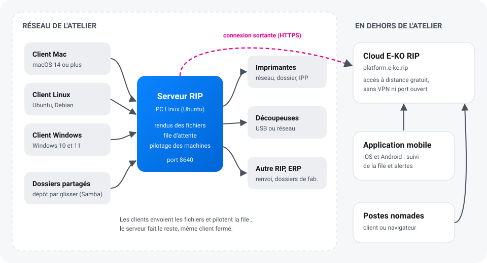

E-KO RIP Center est un RIP d'impression grand format libre et gratuit. Un **serveur** installé
sur un PC Linux de l'atelier reçoit les fichiers, calcule les rendus et pilote les imprimantes et
les découpeuses. Les postes de travail s'y connectent avec le **client** Mac, Linux ou Windows ;
l'**application mobile** suit la production ; le **Cloud E-KO RIP** donne accès à l'atelier
depuis l'extérieur.

## Par où commencer

| Je veux… | Lire |
|---|---|
| Comprendre l'ensemble et installer un atelier pas à pas | [Prise en main](demarrage.md) |
| Installer le serveur sur un PC Linux | [Installer le serveur](serveur.md) |
| Installer le logiciel sur mon Mac, mon PC Linux ou Windows | [Installer les clients](clients.md) |
| Suivre la production sur mon téléphone | [Application mobile](application-mobile.md) |
| Accéder à l'atelier depuis chez moi ou un client | [Cloud E-KO RIP](cloud.md) |
| Envoyer un fichier, imprimer, découper, faire un BAT | [Guide d'utilisation](../../fr/utilisation.md) |
| Brancher et régler une machine | [Machines](../../fr/machines.md) : imprimantes, plotters, tables de découpe |
| Gérer les comptes, sauvegarder, mettre à jour | [Administrer le serveur](administration.md) |
| Comprendre un message d'erreur | [Dépannage](depannage.md) |

## Ce qu'il faut savoir d'abord

- **Tout le travail se fait sur le serveur.** Les clients envoient les fichiers et affichent la
  file ; une fois un fichier envoyé, on peut fermer le client : le rendu et l'impression
  continuent.
- **Un seul serveur pour tout l'atelier.** Tous les postes, Mac, Linux ou Windows, voient la même
  file et les mêmes machines.
- **Le serveur reste dans l'atelier.** Il n'est jamais exposé sur Internet ; pour y accéder de
  l'extérieur, on passe par le [Cloud E-KO RIP](cloud.md), gratuit.
- **Logiciel libre.** Le code est public sous licence AGPL-3.0 sur
  [GitHub](https://github.com/mvignaud/eko-rip-center) ; aucune licence à acheter, aucun
  nombre de postes limité.

> [!TIP]
> Les mots du métier (plaque, laize, BAT, repérage…) sont expliqués dans le
> [glossaire](../../fr/glossaire.md).

## Obtenir de l'aide

- Dans le client : **Signaler un problème…** (menu **Aide** sur Mac, menu principal sur Linux)
  envoie une description et les informations utiles à l'équipe.
- Par e-mail : [contact@e-ko.rip](mailto:contact@e-ko.rip).
- Nouveautés de chaque version : [journal des versions](https://e-ko.rip/changelog/).

Cette documentation suit la dernière version publiée. Elle est mise à jour à chaque changement
du RIP, des clients, de l'application mobile et du Cloud.
