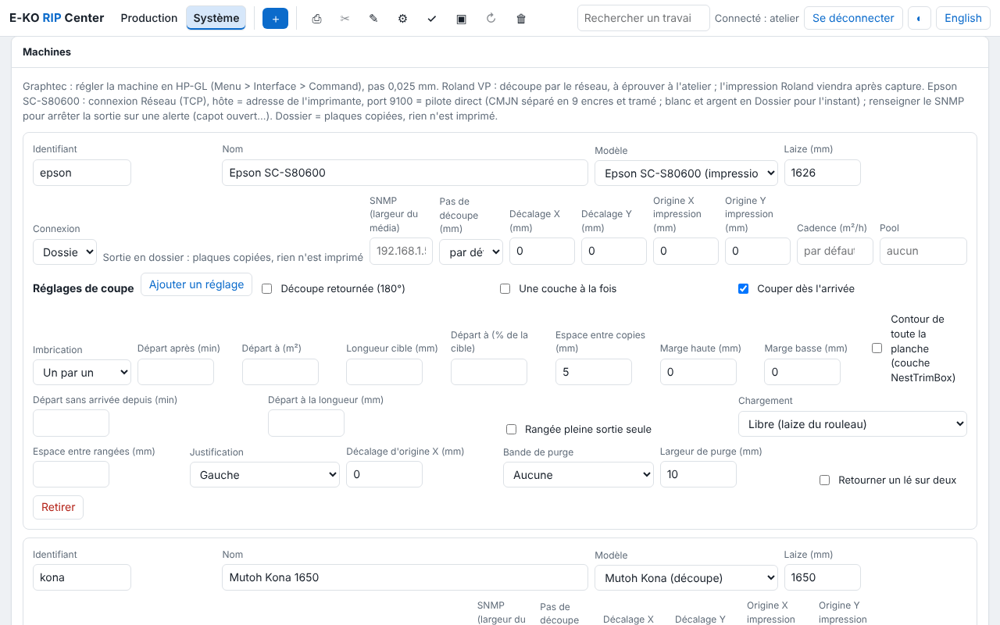

Le serveur est le cœur du RIP : il tourne sous Linux sur un PC de l'atelier, reçoit les fichiers
des postes, calcule les rendus et pilote les machines. Cette page couvre le choix du poste,
l'installation, les comptes et la première mise en route.

## Choisir le poste serveur

Le serveur est le poste qui ne doit pas s'arrêter. Le rendu des fichiers (Ghostscript) est la
tâche la plus lourde.

| | Essais, petit volume | Atelier en production |
|---|---|---|
| **Système** | Ubuntu 24.04 ou 26.04 LTS, Debian 13 | Ubuntu 26.04 LTS |
| **Processeur** | 2 cœurs x86 64 bits | 4 cœurs ou plus |
| **Mémoire** | 16 Go | 16 à 32 Go |
| **Disque des données** | 500 Go | SSD dédié de 1 To ou plus |
| **Réseau** | câble | câble, adresse IP fixe |

Les paquets sont construits pour les PC **x86 64 bits (amd64)**. Plus de mémoire et de cœurs
raccourcissent les rendus de bâches de plusieurs dizaines de m² à haute résolution.

**Disque** : un rendu pèse environ **1 Go par m² à 600 dpi** (le quart à 300 dpi, quatre fois
plus à 1 200 dpi). Un SSD réservé au dossier des données (`/var/lib/eko-rip`), distinct du
disque système, évite qu'un gros rendu remplisse le système. Le monter avant la première mise en
route. Sous 5 Go libres, le serveur efface les plus vieux travaux inactifs et refuse un travail
qui ne tiendrait pas ; sous 20 Go, chaque nouveau travail porte l'alerte « disque presque
plein ».

**Onduleur** : y brancher le serveur, le switch et si possible la box. Une coupure arrête le
rendu en cours (le travail est à relancer) et une sortie en cours d'envoi (à refaire). Les
fichiers de réglage, eux, résistent à la coupure.

**Adresses IP fixes** : à réserver sur le routeur pour le serveur, les imprimantes en réseau
et les découpeuses en réseau.

> [!TIP]
> Les pré-requis complets, avec un comparatif, sont aussi sur la page
> [Pré-requis](https://e-ko.rip/prerequis/) du site.

## Installer par le dépôt APT

C'est la méthode conseillée : le serveur se met ensuite à jour avec le reste du système.
Sur le PC serveur, dans un terminal :

```bash
# 1. Ajouter la clé et le dépôt E-KO (une seule fois)
sudo wget -qO /usr/share/keyrings/eko-rip.gpg https://apt.e-ko.fr/rip/eko-rip.gpg
echo "deb [signed-by=/usr/share/keyrings/eko-rip.gpg] https://apt.e-ko.fr/rip ./" | sudo tee /etc/apt/sources.list.d/eko-rip.list

# 2. Installer le serveur
sudo apt update
sudo apt install eko-rip-serveur
```

Le paquet installe Ghostscript, crée le compte système `eko-rip` et démarre le service
`eko-rip-serveur`, qui redémarre seul avec la machine. Les travaux sont rangés dans
`/var/lib/eko-rip`.

Vérifier qu'il tourne :

```bash
systemctl status eko-rip-serveur
```

Puis ouvrir `http://<adresse-du-serveur>:8640` dans un navigateur d'un autre poste : la page
d'état doit s'afficher.


> [!NOTE]
> Un PC qui sert à la fois de serveur et de poste de travail peut utiliser le script
> d'installation du client (`wget -qO- https://apt.e-ko.fr/rip/installer | sudo sh`), qui ajoute
> le même dépôt : il suffit ensuite de faire `sudo apt install eko-rip-serveur`.

### Sans dépôt : le paquet .deb

Le paquet `eko-rip-serveur_<version>-1_amd64.deb` est aussi joint à chaque version sur
[GitHub](https://github.com/mvignaud/eko-rip-center/releases). L'installer avec :

```bash
sudo apt install ./eko-rip-serveur_<version>-1_amd64.deb
```

Les mises à jour se font alors à la main, de la même façon.

### Ubuntu 26.04

Depuis la version 0.31.0, le paquet autorise Ghostscript à lire les travaux du RIP malgré le
confinement AppArmor d'Ubuntu 26.04. Une version plus ancienne y échoue sur chaque rendu
(« Permission denied ») : mettre à jour.

## Créer les comptes

Sans compte, l'accès est libre pour tout le réseau et l'écran l'affiche en rouge. Le Cloud et
l'application mobile exigent des comptes.

Créer le premier compte (administrateur), sur le serveur :

```bash
sudo -u eko-rip env EKO_RIP_DATA=/var/lib/eko-rip eko-rip-serveur utilisateur ajouter marie
```

Le mot de passe est demandé deux fois, sans s'afficher (10 caractères au moins). Puis un compte
par opérateur :

```bash
sudo -u eko-rip env EKO_RIP_DATA=/var/lib/eko-rip eko-rip-serveur utilisateur ajouter julie operateur
```

| Rôle | Peut |
|---|---|
| **Administrateur** (`admin`) | tout, y compris les machines, supports et tarifs, profils ICC, réglages enregistrés, sauvegarde, Cloud |
| **Opérateur** (`operateur`) | envoyer, éditer, imprimer, découper, gérer la file et les planches ; voit les machines sans pouvoir les régler |

Sans rôle précisé : administrateur s'il n'y en a encore aucun, opérateur sinon. Aucun
redémarrage n'est nécessaire. La gestion courante (liste, mot de passe oublié, suppression)
est dans [Administrer le serveur](administration.md#comptes).

## Brancher les machines

Le serveur parle aux machines par le réseau, en USB ou par un dossier :

- **Imprimante en réseau** (Epson SureColor…) : adresse IP fixe, câble, même réseau que le
  serveur.
- **Découpeuse en USB** (Mutoh Kona…) : un port USB libre sur le serveur ; le service a déjà le
  droit d'y écrire.
- **Découpeuse en réseau** (Graphtec, Roland) : adresse IP fixe.
- **Imprimante de bureau ou autre RIP** : par IPP/CUPS ou par renvoi vers un autre serveur
  E-KO RIP.

Les machines se déclarent ensuite dans le client, **Administration… › Système › Machines**.
Chaque modèle a sa page (réglages sur la machine et dans le RIP, vérifications) dans la
rubrique [Machines](../../fr/machines.md).



## Dossiers surveillés

Chaque réglage enregistré a son dossier : un fichier déposé dedans part au RIP avec ce réglage,
sans ouvrir le client. Pour y déposer depuis les Mac et les PC Windows, partager le dossier
par Samba : voir [Partager les dossiers surveillés](administration.md#partager-les-dossiers-surveillés).

## Réglages du serveur

Les réglages avancés (port, dossier des données, durée de conservation des travaux, taille
maximale d'un fichier…) se font dans `/etc/default/eko-rip-serveur`, puis :

```bash
sudo systemctl restart eko-rip-serveur
```

La liste complète est dans [Administrer le serveur](administration.md#réglages-avancés).

## PC dédié : image d'installation

Pour un PC neuf réservé au RIP, une image d'installation Ubuntu prête à l'emploi (serveur,
client et bureau, ou serveur seul) est décrite dans la
[référence d'installation](https://github.com/mvignaud/eko-rip-center/blob/main/docs/fr/installation-serveur.md#0-pc-dédié--image-dinstallation-ubuntu).
Elle **efface tout le disque** ; le serveur se met ensuite à jour par le dépôt APT.
